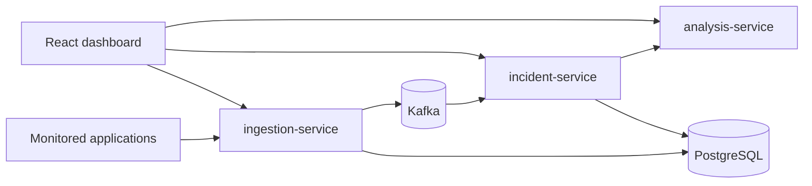

# Software Debugging & Root Cause Platform

A platform for collecting application logs, monitoring errors, correlating related failures into
incidents, detecting recurring problems and identifying likely root causes.

It is built as a set of small services: Java/Spring Boot services for ingestion and incident
processing, a Python service for analysis, Kafka for event streaming, PostgreSQL for storage and a
React dashboard.

> **Project status: Phase 1 — Project foundation.**
> The services, dashboard shell and local infrastructure are in place, but log ingestion, incident
> correlation and root cause analysis are **not implemented yet**. See [Roadmap](#roadmap).

## What works today

- **Two Spring Boot services** (`ingestion-service`, `incident-service`) that start, expose
  Actuator health (including liveness/readiness probes) and info endpoints, and have automated tests.
- **Python analysis service** (FastAPI) with a `GET /health` endpoint and pytest tests.
- **React dashboard** with responsive navigation and four pages:
  - **Service Health** — *live*: polls the three backend services and shows their status and
    response time.
  - **Overview**, **Error Monitoring**, **Root Cause Analysis** — *preview*: starter layouts that
    show no data yet. Each page and navigation item is labelled **Live** or **Preview**.
- **Docker Compose** environment running all services plus PostgreSQL and a single-node Kafka broker
  (KRaft mode), with health checks and persistent volumes.
- **Sample data**: a synthetic JSON Lines log set in [`sample-data/`](sample-data/) for later phases.

## Architecture



This is the target design. In Phase 1, the services run independently and do not yet use Kafka or
PostgreSQL. Details: [docs/architecture.md](docs/architecture.md).

## Technology

| Area | Technology |
| --- | --- |
| Backend services | Java 21, Spring Boot 4.1, Maven (via Maven Wrapper) |
| Analysis service | Python 3.12, FastAPI, Uvicorn, pytest, Ruff |
| Frontend | React 19, TypeScript 6, Vite 8, React Router 8, Vitest, Testing Library, ESLint |
| Messaging | Apache Kafka 4.3 (KRaft, single node) |
| Database | PostgreSQL 17 |
| Runtime | Docker, Docker Compose |

## Repository layout

```text
.
├── backend/
│   ├── ingestion-service/     Spring Boot service (port 8081)
│   └── incident-service/      Spring Boot service (port 8082)
├── analysis-service/          Python FastAPI service (port 8000)
├── frontend/                  React + TypeScript + Vite dashboard
├── database/init/             PostgreSQL initialization scripts
├── sample-data/               Synthetic application logs
├── docs/                      Architecture and configuration notes
├── screenshots/               Dashboard screenshots (added in later phases)
├── docker-compose.yml
└── .env.example               Template for local configuration
```

## Prerequisites

| Tool | Version | Needed for |
| --- | --- | --- |
| Docker Desktop / Docker Engine with Compose v2 | Compose 2.20+ | Running the full stack |
| Java (JDK) | 21 | Running/testing the Spring Boot services outside Docker |
| Python | 3.12+ | Running/testing the analysis service outside Docker |
| Node.js | 22.22+ (24 LTS recommended) | Running/testing the dashboard outside Docker |

Maven does not need to be installed: each Java service includes the Maven Wrapper (`mvnw`).
On Windows, Docker Desktop requires WSL 2.

## Quick start (Docker)

```bash
cp .env.example .env              # Windows PowerShell: Copy-Item .env.example .env
# Edit .env and set POSTGRES_PASSWORD
docker compose up -d --build
docker compose ps                 # wait until every service reports "healthy"
```

If a host port is already in use (for example, a locally installed PostgreSQL on 5432), change the
matching `*_PORT` variable in `.env`, e.g. `POSTGRES_PORT=5433`. Containers still reach each other on
their default ports.

| URL | What |
| --- | --- |
| <http://localhost:3000> | Dashboard |
| <http://localhost:3000/health> | Live service health page |
| <http://localhost:8081/actuator/health> | Ingestion service health |
| <http://localhost:8082/actuator/health> | Incident service health |
| <http://localhost:8000/health> | Analysis service health |
| <http://localhost:8000/docs> | Analysis service OpenAPI docs |

Stop the stack with `docker compose down` (add `-v` to also delete the PostgreSQL and Kafka volumes).

### Health check commands

```bash
curl http://localhost:8081/actuator/health
curl http://localhost:8081/actuator/health/readiness
curl http://localhost:8082/actuator/health
curl http://localhost:8000/health
curl http://localhost:3000/api/ingestion/actuator/health    # through the dashboard proxy

docker compose exec postgres sh -c 'pg_isready -U "$POSTGRES_USER" -d "$POSTGRES_DB"'
docker compose exec kafka /opt/kafka/bin/kafka-broker-api-versions.sh --bootstrap-server localhost:29092
```

## Local development

Each part can also run directly on the host. Use separate terminals.

**Spring Boot services**

```bash
cd backend/ingestion-service      # or backend/incident-service
./mvnw spring-boot:run            # Windows: .\mvnw.cmd spring-boot:run
./mvnw test
```

**Analysis service**

```bash
cd analysis-service
python -m venv .venv
source .venv/bin/activate         # Windows: .venv\Scripts\activate
pip install -e ".[dev]"
uvicorn analysis_service.main:app --reload --port 8000
pytest
ruff check .
```

**Dashboard**

```bash
cd frontend
npm ci
npm run dev                       # http://localhost:5173, proxies /api/* to the local services
npm run lint
npm test
npm run build
```

## Configuration

All Docker Compose settings are read from `.env` (not committed). See
[docs/configuration.md](docs/configuration.md) for every variable and per-service settings.
No credentials are stored in source files.

## Roadmap

| Phase | Scope | Status |
| --- | --- | --- |
| 1 | Project foundation: services, dashboard shell, Docker environment, tests | **Current** |
| 2 | Log ingestion: REST API, validation, persistence in PostgreSQL, publishing to Kafka | Planned |
| 3 | Incident correlation: error fingerprinting, grouping into incidents, recurring failure detection | Planned |
| 4 | Root cause analysis: analysis service evaluates incidents and ranks likely causes with evidence | Planned |
| 5 | Dashboard integration: overview, error monitoring and root cause pages use real data | Planned |
| 6 | CI/CD with GitHub Actions and a public dashboard preview on Cloudflare Pages | Planned |

Scope of later phases may be refined as the project progresses.
