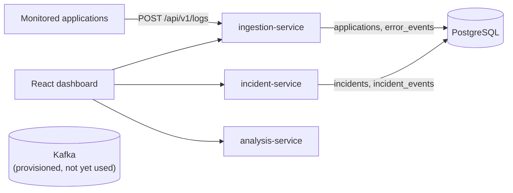

# Software Debugging & Root Cause Platform

A platform for collecting application logs, monitoring errors, correlating related failures into
incidents, detecting recurring problems and identifying likely root causes.

It is built as a set of small services: Java/Spring Boot services for ingestion and incident
processing, a Python service for analysis, Kafka for event streaming, PostgreSQL for storage and a
React dashboard.

> **Project status: Phase 2 — Backend services and PostgreSQL data model.**
> Log events can be ingested, stored and fingerprinted, and incidents can be created and queried
> through REST APIs. Kafka streaming, **automatic** incident correlation and root cause analysis
> are **not implemented yet**, and the dashboard is not yet connected to the new APIs.
> See [Roadmap](#roadmap).

## What works today

- **Log ingestion API** (`ingestion-service`): `POST /api/v1/logs` validates and stores log and
  error events in PostgreSQL, registers new applications automatically and assigns each event a
  deterministic **error fingerprint** so repeated occurrences of the same error can be grouped.
  `GET /api/v1/logs/{id}` returns a stored event.
- **Incident API** (`incident-service`): create an incident from stored error events that share an
  application and fingerprint, retrieve it with its recent events, and list incidents with
  filters (status, severity, application, service, environment) and pagination.
- **PostgreSQL data model** managed by Flyway migrations: applications, error events, incidents
  and incident–event links, with foreign keys, check constraints and indexes.
  See [docs/database.md](docs/database.md).
- **Consistent error handling**: validation errors, malformed input, missing resources and
  conflicts return RFC 9457 problem details with useful 4xx status codes, never stack traces.
- **Structured logging**: JSON (Elastic Common Schema) logs in Docker, with a correlation ID per
  request and identifiers such as event, incident and application IDs.
- **Python analysis service** (FastAPI) with a `GET /health` endpoint. No analysis logic yet.
- **React dashboard** with responsive navigation:
  - **Service Health** — *live*: polls the three backend services and shows their status.
  - **Overview**, **Error Monitoring**, **Root Cause Analysis** — *preview*: layouts that are not
    yet connected to the new APIs. Each page is labelled **Live** or **Preview**.
- **Docker Compose** environment with all services, PostgreSQL and a single-node Kafka broker
  (KRaft). The broker runs but is not used by the services yet.
- **Demo data**: synthetic log events in [`sample-data/`](sample-data/) and a script to send them.

## Architecture



Each Spring Boot service owns a PostgreSQL schema and migrates it on startup. incident-service
reads the events stored by ingestion-service. Event streaming through Kafka, automatic
correlation and the analysis service's logic come in later phases.
Details: [docs/architecture.md](docs/architecture.md).

## Technology

| Area | Technology |
| --- | --- |
| Backend services | Java 21, Spring Boot 4.1 (Web MVC, Data JPA, Validation, Actuator), Hibernate 7, Flyway, Maven Wrapper |
| Backend tests | JUnit 5, AssertJ, Testcontainers (PostgreSQL 17) |
| Analysis service | Python 3.12, FastAPI, Uvicorn, pytest, Ruff |
| Frontend | React 19, TypeScript 6, Vite 8, React Router 8, Vitest, Testing Library, ESLint |
| Messaging | Apache Kafka 4.3 (KRaft, single node) |
| Database | PostgreSQL 17 |
| Runtime | Docker, Docker Compose |

## Repository layout

```text
.
├── backend/
│   ├── ingestion-service/     Log ingestion API (port 8081)
│   └── incident-service/      Incident API (port 8082)
├── analysis-service/          Python FastAPI service (port 8000)
├── frontend/                  React + TypeScript + Vite dashboard
├── database/init/             PostgreSQL initialization (schemas)
├── sample-data/               Demo log events and a loader script
├── docs/                      Architecture, API, database and configuration notes
├── screenshots/               Dashboard screenshots (added in later phases)
├── docker-compose.yml
└── .env.example               Template for local configuration
```

## Prerequisites

| Tool | Version | Needed for |
| --- | --- | --- |
| Docker Desktop / Docker Engine with Compose v2 | Compose 2.20+ | Running the stack and the backend tests (Testcontainers) |
| Java (JDK) | 21 | Running/testing the Spring Boot services outside Docker |
| Python | 3.12+ | Running/testing the analysis service, sending demo data |
| Node.js | 22.22+ (24 LTS recommended) | Running/testing the dashboard outside Docker |

Maven does not need to be installed: each Java service includes the Maven Wrapper (`mvnw`).
On Windows, Docker Desktop requires WSL 2.

## Quick start (Docker)

```bash
cp .env.example .env              # Windows PowerShell: Copy-Item .env.example .env
# Edit .env and set POSTGRES_PASSWORD
docker compose up -d --build
docker compose ps                 # wait until every service reports "healthy"
```

If a host port is already in use (for example, a locally installed PostgreSQL on 5432), change the
matching `*_PORT` variable in `.env`, e.g. `POSTGRES_PORT=5433`. Containers still reach each other on
their default ports.

| URL | What |
| --- | --- |
| <http://localhost:3000> | Dashboard |
| <http://localhost:8081/api/v1/logs> | Log ingestion API (`POST`) |
| <http://localhost:8082/api/v1/incidents> | Incident API |
| <http://localhost:8081/actuator/health> | Ingestion service health |
| <http://localhost:8082/actuator/health> | Incident service health |
| <http://localhost:8000/health> | Analysis service health |
| <http://localhost:8000/docs> | Analysis service OpenAPI docs |

Stop the stack with `docker compose down` (add `-v` to also delete the PostgreSQL and Kafka volumes).

### Try the APIs with demo data

```bash
# Send 10 synthetic events (demo data) to the ingestion API
python sample-data/send_sample_logs.py

# Three payment-service timeouts share one fingerprint. Find their IDs ...
docker compose exec postgres psql -U rootcause -d rootcause -c \
  "SELECT id, event_timestamp, left(fingerprint, 12) FROM ingestion.error_events
   WHERE exception_type = 'java.net.SocketTimeoutException' ORDER BY event_timestamp"

# ... and create an incident from them
curl -X POST http://localhost:8082/api/v1/incidents -H 'Content-Type: application/json' \
  -d '{"errorEventIds": ["<id-1>", "<id-2>", "<id-3>"]}'

curl 'http://localhost:8082/api/v1/incidents?application=demo-shop&status=OPEN'
```

Endpoints, fields, example responses and error codes: [docs/api.md](docs/api.md).

### Health check commands

```bash
curl http://localhost:8081/actuator/health
curl http://localhost:8081/actuator/health/readiness   # includes the database connection
curl http://localhost:8082/actuator/health
curl http://localhost:8000/health
curl http://localhost:3000/api/ingestion/actuator/health    # through the dashboard proxy

docker compose exec postgres sh -c 'pg_isready -U "$POSTGRES_USER" -d "$POSTGRES_DB"'
docker compose exec kafka /opt/kafka/bin/kafka-broker-api-versions.sh --bootstrap-server localhost:29092
```

## Local development

Each part can also run directly on the host. Use separate terminals.

**Spring Boot services**

The services need PostgreSQL. Start it with Docker Compose and point the services at it with
environment variables (the defaults are `localhost:5432`, database and user `rootcause`):

```bash
docker compose up -d postgres
# Use the values from .env. PowerShell: $env:DB_PORT='5432'; $env:DB_PASSWORD='...'
export DB_PORT='<POSTGRES_PORT>' DB_PASSWORD='<POSTGRES_PASSWORD>'

cd backend/ingestion-service      # start this one first: incident tables reference its schema
./mvnw spring-boot:run            # Windows: .\mvnw.cmd spring-boot:run

cd backend/incident-service
./mvnw spring-boot:run
```

Tests start their own throwaway PostgreSQL container with Testcontainers, so they only need a
running Docker engine:

```bash
cd backend/ingestion-service && ./mvnw test
cd backend/incident-service && ./mvnw test
```

**Analysis service**

```bash
cd analysis-service
python -m venv .venv
source .venv/bin/activate         # Windows: .venv\Scripts\activate
pip install -e ".[dev]"
uvicorn analysis_service.main:app --reload --port 8000
pytest
ruff check .
```

**Dashboard**

```bash
cd frontend
npm ci
npm run dev                       # http://localhost:5173, proxies /api/* to the local services
npm run lint
npm test
npm run build
```

## Configuration

All Docker Compose settings are read from `.env` (not committed). See
[docs/configuration.md](docs/configuration.md) for every variable and per-service settings.
No credentials are stored in source files.

## Documentation

- [docs/architecture.md](docs/architecture.md) — components, request routing, health checks, logging
- [docs/api.md](docs/api.md) — REST endpoints with examples and error format
- [docs/database.md](docs/database.md) — data model, constraints, indexes and migrations
- [docs/configuration.md](docs/configuration.md) — environment variables and service settings

## Roadmap

| Phase | Scope | Status |
| --- | --- | --- |
| 1 | Project foundation: services, dashboard shell, Docker environment, tests | Done |
| 2 | Backend services and data model: ingestion API, fingerprinting, incident API, PostgreSQL schema, validation, structured logging | **Current** |
| 3 | Event streaming and correlation: publish events to Kafka, correlate them into incidents automatically, detect recurring failures | Planned |
| 4 | Root cause analysis: analysis service evaluates incidents and ranks likely causes with evidence | Planned |
| 5 | Dashboard integration: overview, error monitoring and root cause pages use real data | Planned |
| 6 | CI/CD with GitHub Actions and a public dashboard preview on Cloudflare Pages | Planned |

Scope of later phases may be refined as the project progresses.
