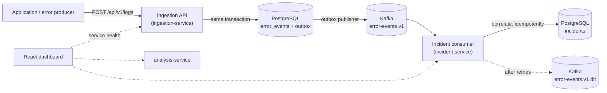

# Software Debugging & Root Cause Platform

A platform for collecting application logs, monitoring errors, correlating related failures into
incidents, detecting recurring problems and identifying likely root causes.

It is built as a set of small services: Java/Spring Boot services for ingestion and incident
processing, a Python service for analysis, Kafka for event streaming, PostgreSQL for storage and a
React dashboard.

> **Project status: Phase 3 — Kafka event streaming and automated incident correlation.**
> Log events are ingested and stored, published reliably to Kafka through a transactional outbox,
> and correlated into incidents automatically by a Kafka consumer. Root cause analysis is **not
> implemented yet**, and the dashboard is not yet connected to the APIs. See [Roadmap](#roadmap).

## What works today

- **Log ingestion API** (`ingestion-service`): `POST /api/v1/logs` validates and stores log and
  error events in PostgreSQL, registers new applications automatically and assigns each event a
  deterministic **error fingerprint**. `GET /api/v1/logs/{id}` returns a stored event.
- **Reliable event publishing**: every stored event is announced as an `ErrorEventCreated`
  message on Kafka topic `error-events.v1`. The message is written to an **outbox table in the
  same transaction** as the event and published in the background, so a Kafka outage never loses
  an accepted event and does not affect the API.
- **Automatic incident correlation** (`incident-service`): a Kafka consumer groups repeated
  occurrences of the same error (same application and fingerprint) into one incident, updating
  its occurrence count, first/last seen and severity. Processing is **idempotent**, so
  redelivered messages are not counted twice; failing messages are **retried a bounded number of
  times** and then moved to a **dead-letter topic**.
- **Incident API**: list incidents with filters (status, severity, application, service,
  environment) and pagination, and retrieve one with its recent events. The Phase 2 manual
  creation endpoint still works but is deprecated.
- **PostgreSQL data model** managed by Flyway migrations, with one schema per service and no
  foreign keys between them. See [docs/database.md](docs/database.md).
- **Consistent error handling**: RFC 9457 problem details with meaningful status codes, never
  stack traces.
- **Structured logging**: JSON (Elastic Common Schema) logs in Docker. A request's correlation ID
  is carried through Kafka, so one ID connects the API call, the publication and the incident
  update; Kafka log lines include topic, partition and offset.
- **Python analysis service** (FastAPI) with a `GET /health` endpoint. No analysis logic yet.
- **React dashboard** with responsive navigation:
  - **Service Health** — *live*: polls the three backend services and shows their status.
  - **Overview**, **Error Monitoring**, **Root Cause Analysis** — *preview*: layouts that are not
    yet connected to the APIs. Each page is labelled **Live** or **Preview**.
- **Docker Compose** environment with all services, PostgreSQL and a single-node Kafka broker
  (KRaft), with health checks and persistent volumes.
- **Demo data**: synthetic log events in [`sample-data/`](sample-data/) and a script that sends them
  and shows the incidents created from them.

## Architecture



ingestion-service returns `201` as soon as the event and its outbox message are committed; it
does not wait for Kafka or for the incident update. incident-service builds incidents only from
Kafka messages. Details: [docs/architecture.md](docs/architecture.md) and
[docs/events.md](docs/events.md).

## Technology

| Area | Technology |
| --- | --- |
| Backend services | Java 21, Spring Boot 4.1 (Web MVC, Data JPA, Validation, Actuator), Spring for Apache Kafka, Hibernate 7, Flyway, Maven Wrapper |
| Backend tests | JUnit 5, AssertJ, Awaitility, Testcontainers (PostgreSQL 17, Kafka 4.3) |
| Analysis service | Python 3.12, FastAPI, Uvicorn, pytest, Ruff |
| Frontend | React 19, TypeScript 6, Vite 8, React Router 8, Vitest, Testing Library, ESLint |
| Messaging | Apache Kafka 4.3 (KRaft, single node) |
| Database | PostgreSQL 17 |
| Runtime | Docker, Docker Compose |

## Repository layout

```text
.
├── backend/
│   ├── ingestion-service/     Log ingestion API (port 8081)
│   └── incident-service/      Incident API (port 8082)
├── analysis-service/          Python FastAPI service (port 8000)
├── frontend/                  React + TypeScript + Vite dashboard
├── database/init/             PostgreSQL initialization (schemas)
├── sample-data/               Demo log events and a loader script
├── docs/                      Architecture, API, database and configuration notes
├── screenshots/               Dashboard screenshots (added in later phases)
├── docker-compose.yml
└── .env.example               Template for local configuration
```

## Prerequisites

| Tool | Version | Needed for |
| --- | --- | --- |
| Docker Desktop / Docker Engine with Compose v2 | Compose 2.20+ | Running the stack and the backend tests (Testcontainers) |
| Java (JDK) | 21 | Running/testing the Spring Boot services outside Docker |
| Python | 3.12+ | Running/testing the analysis service, sending demo data |
| Node.js | 22.22+ (24 LTS recommended) | Running/testing the dashboard outside Docker |

Maven does not need to be installed: each Java service includes the Maven Wrapper (`mvnw`).
On Windows, Docker Desktop requires WSL 2.

## Quick start (Docker)

```bash
cp .env.example .env              # Windows PowerShell: Copy-Item .env.example .env
# Edit .env and set POSTGRES_PASSWORD
docker compose up -d --build
docker compose ps                 # wait until every service reports "healthy"
```

If a host port is already in use (for example, a locally installed PostgreSQL on 5432), change the
matching `*_PORT` variable in `.env`, e.g. `POSTGRES_PORT=5433`. Containers still reach each other on
their default ports.

| URL | What |
| --- | --- |
| <http://localhost:3000> | Dashboard |
| <http://localhost:8081/api/v1/logs> | Log ingestion API (`POST`) |
| <http://localhost:8082/api/v1/incidents> | Incident API |
| <http://localhost:8081/actuator/health> | Ingestion service health |
| <http://localhost:8082/actuator/health> | Incident service health |
| <http://localhost:8000/health> | Analysis service health |
| <http://localhost:8000/docs> | Analysis service OpenAPI docs |

Stop the stack with `docker compose down` (add `-v` to also delete the PostgreSQL and Kafka volumes).

### Try the APIs with demo data

```bash
# Send 10 synthetic events (demo data) and wait for the incidents created from them
python sample-data/send_sample_logs.py --application demo-shop-trial
```

The ten events contain three occurrences of the same payment timeout, two occurrences of a
checkout failure, two other errors and three `INFO`/`WARN` events. Example output:

```text
Incidents for 'demo-shop-trial' (created automatically via Kafka):
    2 x  checkout-service   OPEN    com.shop.checkout.PaymentFailedException: Order could not be completed
    3 x  payment-service    OPEN    java.net.SocketTimeoutException: Payment authorization failed
    1 x  catalog-service    OPEN    java.lang.NullPointerException: Failed to render product page
    1 x  inventory-service  OPEN    org.springframework.dao.DataAccessResourceFailureException: Unable to ...
```

Running it again with the same `--application` adds the new occurrences to the same open
incidents. Query the incident API directly:

```bash
curl 'http://localhost:8082/api/v1/incidents?application=demo-shop-trial&status=OPEN'
curl 'http://localhost:8082/api/v1/incidents/<incident-id>'
```

Endpoints, fields, example responses and error codes: [docs/api.md](docs/api.md). Inspecting
topics, consumer lag and the outbox: [docs/events.md](docs/events.md#inspecting-topics-locally).

### Health check commands

```bash
curl http://localhost:8081/actuator/health
curl http://localhost:8081/actuator/health/readiness   # includes the database connection
curl http://localhost:8082/actuator/health
curl http://localhost:8000/health
curl http://localhost:3000/api/ingestion/actuator/health    # through the dashboard proxy

docker compose exec postgres sh -c 'pg_isready -U "$POSTGRES_USER" -d "$POSTGRES_DB"'
docker compose exec kafka /opt/kafka/bin/kafka-broker-api-versions.sh --bootstrap-server localhost:29092
```

## Local development

Each part can also run directly on the host. Use separate terminals.

**Spring Boot services**

The services need PostgreSQL and Kafka. Start both with Docker Compose and point the services at
them with environment variables. The defaults are `localhost:5432` (database and user
`rootcause`) and Kafka at `localhost:9092`, the broker's host listener:

```bash
docker compose up -d postgres kafka
# Use the values from .env. PowerShell: $env:DB_PORT='5432'; $env:DB_PASSWORD='...'
export DB_PORT='<POSTGRES_PORT>' DB_PASSWORD='<POSTGRES_PASSWORD>'

cd backend/ingestion-service      # start this one first: incident tables reference its schema
./mvnw spring-boot:run            # Windows: .\mvnw.cmd spring-boot:run

cd backend/incident-service
./mvnw spring-boot:run
```

Tests start their own throwaway PostgreSQL and Kafka containers with Testcontainers, so they only
need a running Docker engine:

```bash
cd backend/ingestion-service && ./mvnw test
cd backend/incident-service && ./mvnw test
```

**Analysis service**

```bash
cd analysis-service
python -m venv .venv
source .venv/bin/activate         # Windows: .venv\Scripts\activate
pip install -e ".[dev]"
uvicorn analysis_service.main:app --reload --port 8000
pytest
ruff check .
```

**Dashboard**

```bash
cd frontend
npm ci
npm run dev                       # http://localhost:5173, proxies /api/* to the local services
npm run lint
npm test
npm run build
```

## Configuration

All Docker Compose settings are read from `.env` (not committed). See
[docs/configuration.md](docs/configuration.md) for every variable and per-service settings.
No credentials are stored in source files.

## Documentation

- [docs/architecture.md](docs/architecture.md) — components, request routing, health checks, logging
- [docs/api.md](docs/api.md) — REST endpoints with examples and error format
- [docs/events.md](docs/events.md) — Kafka topics, `ErrorEventCreated` contract, outbox, correlation, idempotency, retries and dead-letter topic
- [docs/database.md](docs/database.md) — data model, constraints, indexes and migrations
- [docs/configuration.md](docs/configuration.md) — environment variables and service settings

## Roadmap

| Phase | Scope | Status |
| --- | --- | --- |
| 1 | Project foundation: services, dashboard shell, Docker environment, tests | Done |
| 2 | Backend services and data model: ingestion API, fingerprinting, incident API, PostgreSQL schema, validation, structured logging | Done |
| 3 | Event streaming and correlation: transactional outbox, Kafka publishing, automatic and idempotent incident correlation, retries and dead-letter topic | **Current** |
| 4 | Root cause analysis: analysis service evaluates incidents and ranks likely causes with evidence | Planned |
| 5 | Dashboard integration: overview, error monitoring and root cause pages use real data | Planned |
| 6 | CI/CD with GitHub Actions and a public dashboard preview on Cloudflare Pages | Planned |

Scope of later phases may be refined as the project progresses.
