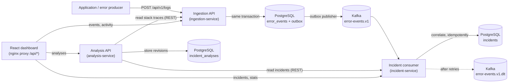
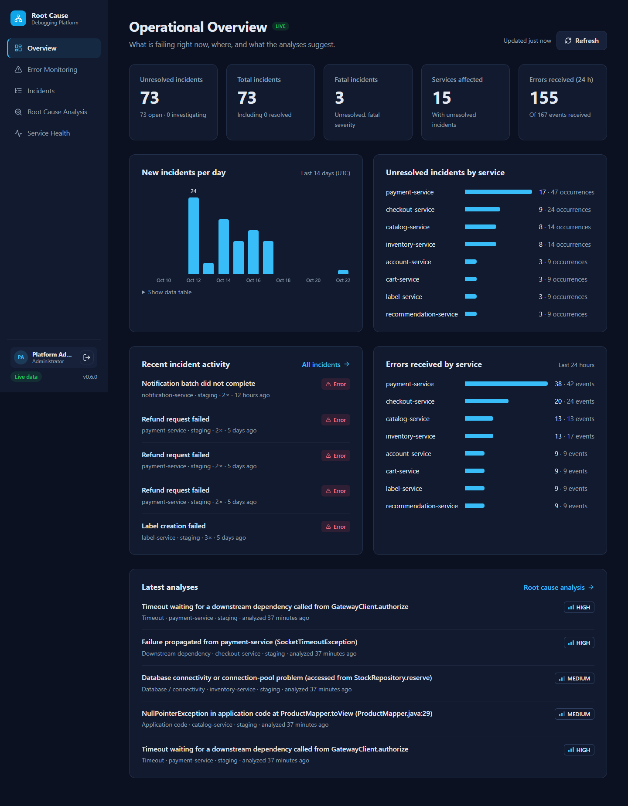
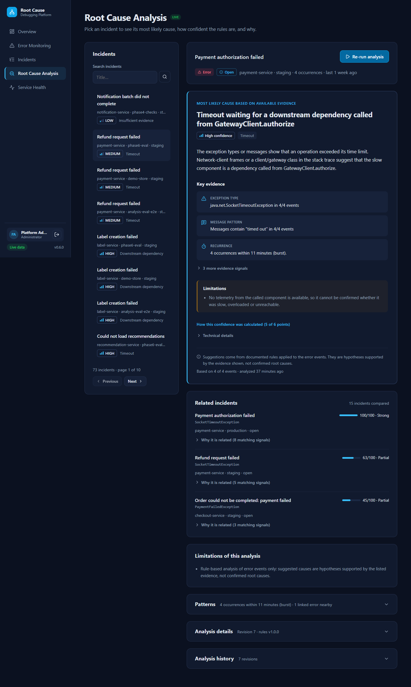
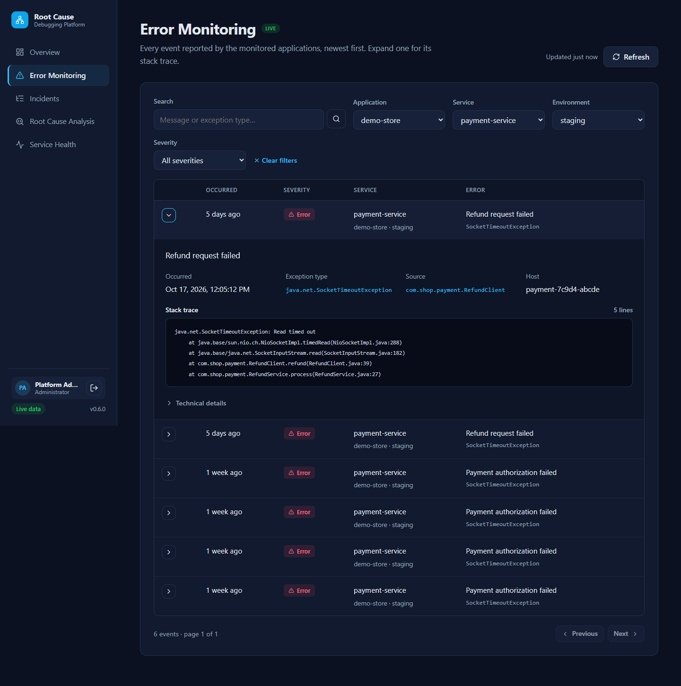
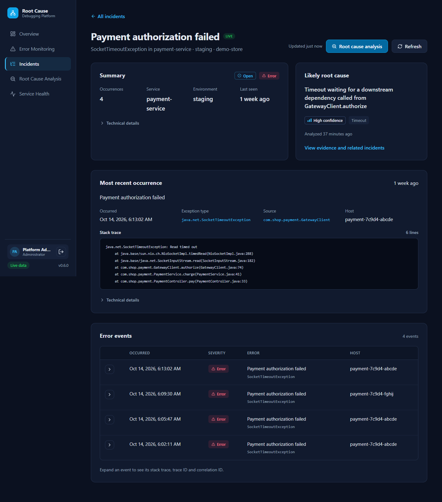
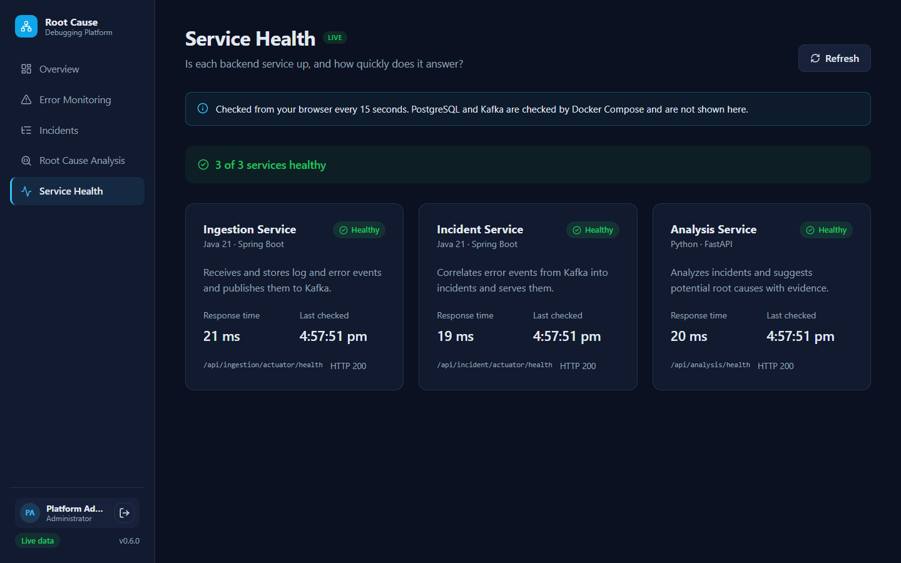
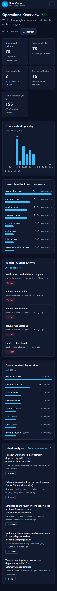
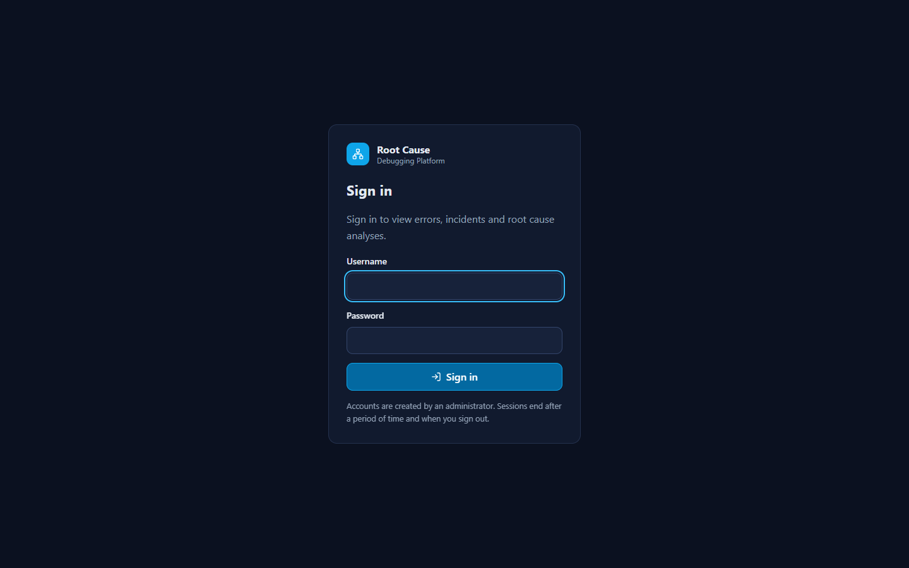
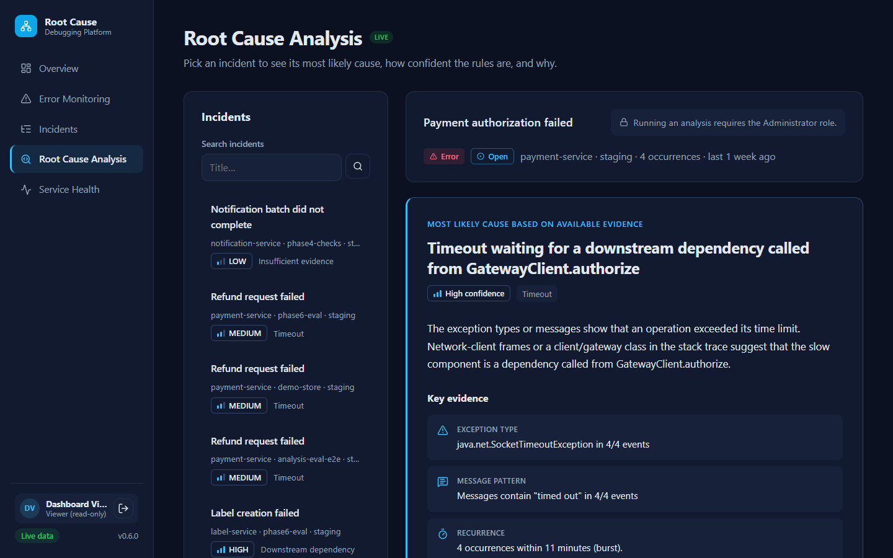

# Software Debugging & Root Cause Platform

A platform for collecting application logs, monitoring errors, correlating related failures into
incidents, detecting recurring problems and identifying likely root causes.

It is built as a set of small services: Java/Spring Boot services for ingestion and incident
processing, a Python service for analysis, Kafka for event streaming, PostgreSQL for storage and a
React dashboard.

> **Project status: Phase 6 — authentication and security hardening.**
> Log events are ingested, published reliably to Kafka and correlated into incidents
> automatically. The analysis service suggests **potential** root causes with evidence, using
> deterministic rules (no machine learning, no external AI service). The React dashboard shows
> all of it from the real APIs after signing in, and can also run as a clearly labelled demo with
> bundled synthetic data. See [Roadmap](#roadmap).

## What works today

- **Log ingestion API** (`ingestion-service`): `POST /api/v1/logs` validates and stores log and
  error events in PostgreSQL, registers new applications automatically and assigns each event a
  deterministic **error fingerprint**. `GET /api/v1/logs/{id}` returns a stored event.
- **Reliable event publishing**: every stored event is announced as an `ErrorEventCreated`
  message on Kafka topic `error-events.v1`. The message is written to an **outbox table in the
  same transaction** as the event and published in the background, so a Kafka outage never loses
  an accepted event and does not affect the API.
- **Automatic incident correlation** (`incident-service`): a Kafka consumer groups repeated
  occurrences of the same error (same application and fingerprint) into one incident, updating
  its occurrence count, first/last seen and severity. Processing is **idempotent**, so
  redelivered messages are not counted twice; failing messages are **retried a bounded number of
  times** and then moved to a **dead-letter topic**.
- **Incident API**: list incidents with filters (status, severity, application, service, title,
  environment) and pagination, and retrieve one with its recent events. The Phase 2 manual
  creation endpoint still works but is deprecated.
- **PostgreSQL data model** managed by Flyway migrations, with one schema per service and no
  foreign keys between them. See [docs/database.md](docs/database.md).
- **Consistent error handling**: RFC 9457 problem details with meaningful status codes, never
  stack traces.
- **Structured logging**: JSON (Elastic Common Schema) logs in Docker. A request's correlation ID
  is carried through Kafka, so one ID connects the API call, the publication and the incident
  update; Kafka log lines include topic, partition and offset.
- **Incident analysis** (`analysis-service`, Python/FastAPI): `POST /api/v1/analysis/incidents/{id}`
  examines an incident and its events and returns:
  - **recurring patterns**: burst/recurring/persistent, repeated exceptions and code locations,
    host concentration, and errors in other services that preceded it in the same trace;
  - **related incidents**, ranked by a documented similarity score with the matching signals;
  - **potential root causes** in categories such as timeout, downstream dependency, database,
    application code, authentication, serialization, configuration or resource exhaustion, each
    with its evidence, a `LOW`/`MEDIUM`/`HIGH` confidence and its calculation, and limitations.

  It normalizes messages (IDs, timestamps, addresses), parses Java and Python stack traces, and
  reads incidents and events only through the other services' REST APIs. Results are stored as
  revisions. On 16 labelled synthetic scenarios the rules give the expected category for all 16;
  these scenarios were written together with the rules, so this is a regression check, not a
  measure of real-world accuracy. See [docs/analysis.md](docs/analysis.md).
- **React dashboard** on the real APIs (see [Dashboard](#dashboard)): overview figures and
  charts, error events with filters and stack traces, incidents with filters and details, root
  cause analysis with evidence, confidence and related incidents, and live service health. Every
  page handles loading, empty and unavailable states, and works from 390 px phones to desktops.
- **Authentication and authorization** (see [docs/security.md](docs/security.md)): sign-in with
  username and password (BCrypt hashes), signed access tokens in an HttpOnly, SameSite=Strict
  cookie with CSRF protection, `VIEWER` and `ADMIN` roles enforced by every service, an ingestion
  API key for monitored applications and an internal service token for analysis-service's calls.
  Also rate limits for sign-in, events and analyses, request size limits, security headers and
  structured security logs.
- **Docker Compose** environment with all services, PostgreSQL and a single-node Kafka broker
  (KRaft), with health checks and persistent volumes.
- **Demo data**: synthetic log events in [`sample-data/`](sample-data/) and a script that sends them
  and shows the incidents created from them; a **demo mode** of the dashboard
  (`npm run build:demo`) that serves bundled synthetic data without any backend.

## Architecture



ingestion-service returns `201` as soon as the event and its outbox message are committed; it
does not wait for Kafka or for the incident update. incident-service builds incidents only from
Kafka messages. analysis-service runs on request and is not part of that pipeline. Details:
[docs/architecture.md](docs/architecture.md), [docs/events.md](docs/events.md) and
[docs/analysis.md](docs/analysis.md).

## Technology

| Area | Technology |
| --- | --- |
| Backend services | Java 21, Spring Boot 4.1 (Web MVC, Data JPA, Validation, Actuator), Spring for Apache Kafka, Hibernate 7, Flyway, Maven Wrapper |
| Backend tests | JUnit 5, AssertJ, Awaitility, Testcontainers (PostgreSQL 17, Kafka 4.3) |
| Analysis service | Python 3.12, FastAPI, Uvicorn, Pydantic, HTTPX, psycopg 3; Python standard library for the analysis itself (`re`, `collections`, `statistics`) |
| Analysis tests | pytest, Testcontainers (PostgreSQL 17), Ruff |
| Frontend | React 19, TypeScript 6, Vite 8, React Router 8, Vitest, Testing Library, ESLint |
| Messaging | Apache Kafka 4.3 (KRaft, single node) |
| Database | PostgreSQL 17 |
| Runtime | Docker, Docker Compose |

## Repository layout

```text
.
├── backend/
│   ├── ingestion-service/     Log ingestion API (port 8081)
│   └── incident-service/      Incident API, user accounts and sign-in (port 8082)
├── analysis-service/          Incident analysis API, Python/FastAPI (port 8000)
├── frontend/                  React + TypeScript + Vite dashboard
├── database/init/             PostgreSQL initialization (schemas)
├── sample-data/               Demo log events, a loader script, labelled analysis scenarios
├── docs/                      Architecture, API, database, configuration and security notes
├── screenshots/               Dashboard screenshots
├── docker-compose.yml
└── .env.example               Template for local configuration
```

## Prerequisites

| Tool | Version | Needed for |
| --- | --- | --- |
| Docker Desktop / Docker Engine with Compose v2 | Compose 2.20+ | Running the stack and the backend tests (Testcontainers) |
| Java (JDK) | 21 | Running/testing the Spring Boot services outside Docker |
| Python | 3.12+ | Running/testing the analysis service, sending demo data |
| Node.js | 22.22+ (24 LTS recommended) | Running/testing the dashboard outside Docker |

Maven does not need to be installed: each Java service includes the Maven Wrapper (`mvnw`).
On Windows, Docker Desktop requires WSL 2.

## Quick start (Docker)

```bash
cp .env.example .env              # Windows PowerShell: Copy-Item .env.example .env
# Edit .env: set POSTGRES_PASSWORD, AUTH_JWT_SECRET, INTERNAL_SERVICE_TOKEN, INGESTION_API_KEY
# (random values, e.g. from: python -c "import secrets; print(secrets.token_urlsafe(48))")
# and AUTH_BOOTSTRAP_ADMIN_PASSWORD, the password of the first administrator (12+ characters).
docker compose up -d --build
docker compose ps                 # wait until every service reports "healthy"
```

Then open <http://localhost:3000> and sign in as `admin` (or the
`AUTH_BOOTSTRAP_ADMIN_USERNAME` you chose) with your password. The account is created on the
first start only; change its password after signing in on any shared machine
([docs/security.md](docs/security.md#initial-accounts)). Optionally set
`AUTH_BOOTSTRAP_VIEWER_USERNAME`/`_PASSWORD` for a read-only account.

If a host port is already in use (for example, a locally installed PostgreSQL on 5432), change the
matching `*_PORT` variable in `.env`, e.g. `POSTGRES_PORT=5433`. Containers still reach each other on
their default ports.

| URL | What |
| --- | --- |
| <http://localhost:3000> | **Dashboard**, after signing in (all APIs are also reachable through it under `/api/ingestion`, `/api/incident`, `/api/analysis`) |
| <http://localhost:8082/api/v1/auth/login> | Sign-in API (`POST`) |
| <http://localhost:8081/api/v1/logs> | Log ingestion API (`POST` with `X-Api-Key`) |
| <http://localhost:8082/api/v1/incidents> | Incident API |
| <http://localhost:8081/actuator/health> | Ingestion service health |
| <http://localhost:8082/actuator/health> | Incident service health |
| <http://localhost:8000/api/v1/analysis/incidents/{id}> | Analysis API (`POST` to analyze, `GET` for the latest result) |
| <http://localhost:8000/health> | Analysis service health |
| <http://localhost:8000/docs> | Analysis service OpenAPI docs |

Stop the stack with `docker compose down` (add `-v` to also delete the PostgreSQL and Kafka volumes).

### Try it with demo data

```bash
# Send 10 synthetic events (demo data), wait for the incidents created from them and analyze them
python sample-data/send_sample_logs.py --application demo-shop-trial --analyze
```

The script sends the events with `INGESTION_API_KEY` and signs in to read and analyze the
incidents. Both are taken from environment variables or, for local development, from `.env`
(the bootstrap admin unless `RCP_USERNAME`/`RCP_PASSWORD` are set); they are never printed.

The ten events contain three occurrences of the same payment timeout, two occurrences of a
checkout failure, two other errors and three `INFO`/`WARN` events. Example output:

```text
Incidents for 'demo-shop-trial' (created automatically via Kafka):
    2 x  checkout-service   OPEN    com.shop.checkout.PaymentFailedException: Order could not be completed
    3 x  payment-service    OPEN    java.net.SocketTimeoutException: Payment authorization failed
    1 x  catalog-service    OPEN    java.lang.NullPointerException: Failed to render product page
    1 x  inventory-service  OPEN    org.springframework.dao.DataAccessResourceFailureException: Unable to ...

Analysis (rule-based; potential causes, not confirmed root causes):
  checkout-service   DOWNSTREAM_DEPENDENCY  HIGH    Failure propagated from payment-service (SocketTimeoutException)
  payment-service    TIMEOUT                HIGH    Timeout waiting for a downstream dependency called from GatewayClient.authorize
  catalog-service    APPLICATION_CODE       MEDIUM  NullPointerException in application code at ProductMapper.toView (ProductMapper.
  inventory-service  DATABASE               MEDIUM  Database connectivity or connection-pool problem (accessed from StockRepository.
```

The single-occurrence incidents are capped at `MEDIUM`; every result lists its evidence, the
confidence calculation and its limitations.

Running it again with the same `--application` adds the new occurrences to the same open
incidents. Open <http://localhost:3000> to see the events, incidents and analyses in the
dashboard. For a larger set (16 labelled scenarios across 13 services), run
`python -m evaluation --live --application demo-store` in `analysis-service/` (same
credentials). To query the APIs directly, sign in first and use the token
([docs/api.md](docs/api.md#signing-in-with-curl)):

```bash
curl -H "Authorization: Bearer $TOKEN" 'http://localhost:8082/api/v1/incidents?application=demo-shop-trial&status=OPEN'
curl -H "Authorization: Bearer $TOKEN" 'http://localhost:8082/api/v1/incidents/<incident-id>'
curl -H "Authorization: Bearer $TOKEN" -X POST 'http://localhost:8000/api/v1/analysis/incidents/<incident-id>'   # ADMIN only
curl -H "Authorization: Bearer $TOKEN" 'http://localhost:8000/api/v1/analysis/incidents/<incident-id>/history'
```

Endpoints, fields, example responses and error codes: [docs/api.md](docs/api.md). Inspecting
topics, consumer lag and the outbox: [docs/events.md](docs/events.md#inspecting-topics-locally).

### Health check commands

Health endpoints are public; everything else needs credentials.

```bash
curl http://localhost:8081/actuator/health
curl http://localhost:8081/actuator/health/readiness   # includes the database connection
curl http://localhost:8082/actuator/health
curl http://localhost:8000/health
curl http://localhost:8000/health/readiness             # includes the database connection
curl http://localhost:3000/api/ingestion/actuator/health    # through the dashboard proxy

docker compose exec postgres sh -c 'pg_isready -U "$POSTGRES_USER" -d "$POSTGRES_DB"'
docker compose exec kafka /opt/kafka/bin/kafka-broker-api-versions.sh --bootstrap-server localhost:29092
```

## Local development

Each part can also run directly on the host. Use separate terminals.

**Spring Boot services**

The services need PostgreSQL and Kafka. Start both with Docker Compose and point the services at
them with environment variables. The defaults are `localhost:5432` (database and user
`rootcause`) and Kafka at `localhost:9092`, the broker's host listener:

```bash
docker compose up -d postgres kafka
# Use the values from .env. PowerShell: $env:DB_PORT='5432'; $env:DB_PASSWORD='...'
export DB_PORT='<POSTGRES_PORT>' DB_PASSWORD='<POSTGRES_PASSWORD>'
# Both services also need the auth secrets (see docs/configuration.md#authentication):
export AUTH_JWT_SECRET='<from .env>' INTERNAL_SERVICE_TOKEN='<from .env>'
export INGESTION_API_KEY='<from .env>'                 # ingestion-service
export AUTH_BOOTSTRAP_ADMIN_USERNAME=admin AUTH_BOOTSTRAP_ADMIN_PASSWORD='<from .env>'   # incident-service

cd backend/ingestion-service      # start this one first: incident tables reference its schema
./mvnw spring-boot:run            # Windows: .\mvnw.cmd spring-boot:run

cd backend/incident-service
./mvnw spring-boot:run
```

Tests start their own throwaway PostgreSQL and Kafka containers with Testcontainers, so they only
need a running Docker engine:

```bash
cd backend/ingestion-service && ./mvnw test
cd backend/incident-service && ./mvnw test
```

**Analysis service**

```bash
cd analysis-service
python -m venv .venv
source .venv/bin/activate         # Windows: .venv\Scripts\activate
pip install -e ".[dev]"
pytest                            # API/persistence tests start PostgreSQL with Testcontainers
ruff check .
python -m evaluation              # evaluation on the labelled synthetic scenarios
# Run on the host (needs PostgreSQL; analysis requests also need the other two services):
# export DB_PORT='<POSTGRES_PORT>' DB_PASSWORD='<POSTGRES_PASSWORD>' \
#   AUTH_JWT_SECRET='<from .env>' INTERNAL_SERVICE_TOKEN='<from .env>'; python -m analysis_service
```

**Dashboard**

```bash
cd frontend
npm ci
npm run dev                       # http://localhost:5173, proxies /api/* to the local services
npm run dev:demo                  # demo mode: bundled synthetic data, no backend needed
npm run lint
npm test
npm run build                     # live build (used by the Docker image)
npm run build:demo                # static demo build in dist-demo/
```

## Dashboard

Every page needs a signed-in user. Visiting a page while signed out leads to the sign-in page and
back to that page afterwards; when the session expires (60 minutes by default) or is rejected,
the dashboard returns to sign-in with a message. The sidebar shows the user's name and role and
the sign-out button. A `VIEWER` sees everything but cannot run analyses (the button is replaced by
a note, and analysis-service refuses the request anyway); an `ADMIN` can.

| Page | What it shows |
| --- | --- |
| **Overview** | Unresolved, total and fatal incidents, services affected, errors received in the last 24 h; new incidents per day, unresolved incidents by service, errors by service; recent incident activity and latest analyses. Refreshes every 30 s |
| **Error Monitoring** | Events newest first with time, severity, service and message; filters for text, application, service, environment and severity; expand an event for its source, host and stack trace, with trace/correlation IDs and fingerprint under *Technical details* |
| **Incidents** | Incidents with severity, status, service, occurrences, last activity and analysis state; filters for text, status, severity, application, service and environment |
| **Incident detail** | Key facts (occurrences, service, environment, last seen), the likely root cause, the most recent occurrence with its stack trace, and the recent events; fingerprint, IDs and exact first/last times under *Technical details* |
| **Root Cause Analysis** | Pick an incident, see its stored analysis or run one. First the likely cause ("Most likely cause based on available evidence" only for `HIGH`, otherwise "Potential root cause") with confidence band, category, explanation, the three strongest evidence signals and its limitations; then related incidents, other candidates and the limitations of the analysis. The remaining evidence, the point calculation, the affected code location, matching signals, patterns, revision details and history are collapsed |
| **Service Health** | Live checks of the three services every 15 s with status, response time and last check |

Each page shows the essentials first; long identifiers and secondary metadata stay one click away
in collapsed sections rather than being removed. Incident titles (`<exception type>: <message>`)
are shown as the message with the short exception name beneath it; the full title is in the hover
text. On phones, incident and event tables become one card per row.

Filters and page numbers are part of the URL. Each section loads on its own, so an unavailable
service shows a clear message with a Retry button in the sections that need it while the rest of
the page keeps working. Confidence is always shown as `LOW`/`MEDIUM`/`HIGH`, never as a
percentage.

**Live and demo mode.** The normal build (Docker, `npm run dev`) only uses the real APIs, requires
signing in and shows "Live" on every page. The demo build (`npm run build:demo`) shows bundled synthetic data captured
from a local run of the platform, marks every page "Demo data" with a banner, and makes no API
requests; it cannot ingest or analyze anything. It needs no sign-in: a synthetic "Demo visitor"
session is built in, without any credentials. See
[frontend/src/demo/README.md](frontend/src/demo/README.md).

### Screenshots

Taken from the running Docker stack with synthetic data (see [screenshots/](screenshots/)).

| Overview | Root Cause Analysis |
| --- | --- |
|  |  |

| Error Monitoring | Incident detail |
| --- | --- |
|  |  |

| Service Health | Phone (390 px) |
| --- | --- |
|  |  |

| Sign-in | Signed in as a viewer |
| --- | --- |
|  |  |

## Configuration

All Docker Compose settings are read from `.env` (not committed). See
[docs/configuration.md](docs/configuration.md) for every variable and per-service settings.
No credentials are stored in source files; Compose refuses to start until the required secrets
are set, and each service receives only the secrets it needs.

## Documentation

- [docs/architecture.md](docs/architecture.md) — components, request routing, health checks, logging
- [docs/api.md](docs/api.md) — REST endpoints with examples and error format
- [frontend/README.md](frontend/README.md) — dashboard pages, structure and commands
- [docs/analysis.md](docs/analysis.md) — how incidents are analyzed: normalization, stack traces, rules, confidence, similarity, evaluation and limitations
- [docs/events.md](docs/events.md) — Kafka topics, `ErrorEventCreated` contract, outbox, correlation, idempotency, retries and dead-letter topic
- [docs/database.md](docs/database.md) — data model, constraints, indexes and migrations
- [docs/configuration.md](docs/configuration.md) — environment variables and service settings
- [docs/security.md](docs/security.md) — authentication, roles, tokens, CSRF, service-to-service authentication, rate limits, headers and limitations

## Roadmap

| Phase | Scope | Status |
| --- | --- | --- |
| 1 | Project foundation: services, dashboard shell, Docker environment, tests | Done |
| 2 | Backend services and data model: ingestion API, fingerprinting, incident API, PostgreSQL schema, validation, structured logging | Done |
| 3 | Event streaming and correlation: transactional outbox, Kafka publishing, automatic and idempotent incident correlation, retries and dead-letter topic | Done |
| 4 | Root cause analysis: rule-based analysis service with recurring patterns, related incidents and ranked potential causes with evidence | Done |
| 5 | Dashboard integration: all pages on the real APIs, incidents and incident detail, analysis with evidence, demo mode | Done |
| 6 | Authentication and security hardening: sign-in, roles, protected APIs, service credentials, CSRF, rate limits, security headers | **Current** |
| 7 | Monitoring and operations polish | Planned |
| 8 | CI/CD with GitHub Actions and a public dashboard preview on Cloudflare Pages | Planned |

Scope of later phases may be refined as the project progresses.
