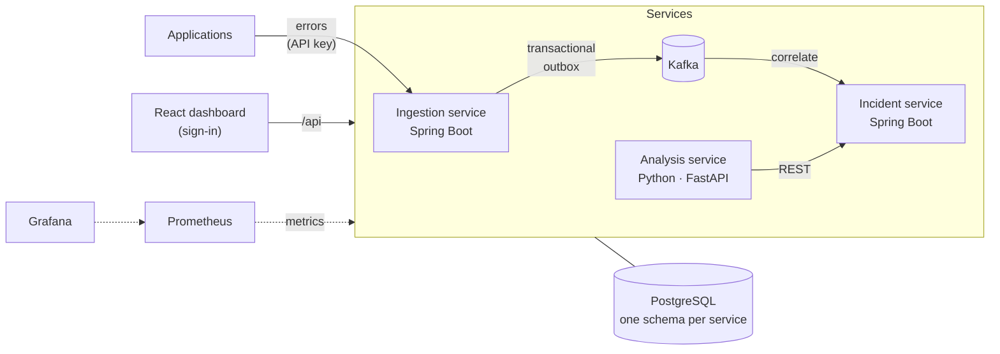
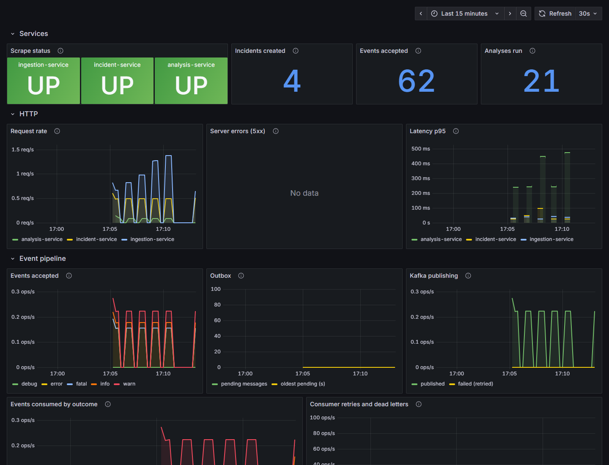

# Software Debugging & Root Cause Platform

[](https://github.com/rciripireddy/ai-software-debugging-root-cause-platform/actions/workflows/ci.yml)

An event-driven debugging and incident analysis platform. Applications send their logs and
errors to an ingestion API; recurring failures are grouped into incidents through Kafka; a
rule-based analysis engine suggests **potential root causes with the evidence behind them**; and a
React dashboard shows it all. Built as Spring Boot and FastAPI services with PostgreSQL, Kafka,
Docker, Prometheus and Grafana.

## Live demo

**[ai-root-cause-platform.pages.dev](https://ai-root-cause-platform.pages.dev)**: the real
dashboard as an interactive demo on **bundled synthetic data**. No sign-in needed: explore error
events and stack traces, incidents, root cause analyses with evidence and related incidents.

The public demo is a static site (Cloudflare Pages); no backend service is exposed. The complete
platform runs locally with Docker, see [Getting started](#getting-started).

## Features

- **Error ingestion API** that validates and stores log events and gives each error a
  deterministic fingerprint.
- **Reliable event streaming**: each accepted event is stored together with a message in a
  **transactional outbox** and then published to **Kafka**, so a Kafka outage never loses an
  accepted event.
- **Automatic incident correlation**: a Kafka consumer groups repeated errors into incidents,
  idempotently, with bounded retries and a dead-letter topic.
- **Explainable root cause analysis**: a deterministic, rule-based engine parses Java and Python
  stack traces, detects recurring patterns and failures propagated across services, finds related
  incidents, and ranks potential causes (timeout, database, downstream dependency, configuration,
  ...) with their evidence, a `LOW`/`MEDIUM`/`HIGH` confidence and how it was calculated.
- **React dashboard**: overview, error monitoring, incidents, root cause analysis and service
  health, from phones to desktops.
- **Authentication and roles**: sign-in, `ADMIN` and `VIEWER` roles enforced by every service,
  API keys for log producers and service-to-service credentials.
- **Observability**: structured JSON logs with one correlation ID across the proxy, services and
  Kafka; liveness and readiness checks; Prometheus metrics and alert rules; a Grafana dashboard.
- **Hardened Docker runtime**: non-root, read-only containers on separate networks; recovers on
  its own after database, Kafka or service outages.
- **Automated testing and CI**: hundreds of unit, API and Testcontainers integration tests, and a
  GitHub Actions pipeline with image builds and an end-to-end smoke test.

## How it works



1. An application posts an error to the **ingestion service**. The event and an outbox message
   are committed in one transaction, and a background publisher sends the message to Kafka.
2. The **incident service** consumes it and adds the occurrence to the open incident with the same
   fingerprint, or opens a new one. Duplicate deliveries are ignored.
3. On request (`ADMIN` only), the **analysis service** reads the incident and its events, applies
   documented rules and scores, and stores the result as a new revision.
4. The **dashboard** reads all three services through its nginx proxy. Each service verifies the
   user's signed token itself.

Details: [architecture](docs/architecture.md), [events and Kafka](docs/events.md),
[analysis engine](docs/analysis.md).

## Technology

| Area | Technology |
| --- | --- |
| Services | Java 21, Spring Boot 4 (Web MVC, Data JPA, Spring Security, Actuator), Spring for Apache Kafka, Flyway |
| Analysis | Python 3.12, FastAPI, Pydantic, psycopg 3; the engine itself uses only the standard library |
| Data and messaging | PostgreSQL 17, Apache Kafka 4 (KRaft) |
| Dashboard | React 19, TypeScript, Vite, React Router |
| Runtime and monitoring | Docker, Docker Compose, nginx, Prometheus, Grafana, Micrometer |
| Testing | JUnit 5, Testcontainers, pytest, Ruff, Vitest, Testing Library, ESLint |
| CI and hosting | GitHub Actions; Cloudflare Pages for the static demo |

## Screenshots

From the local Docker stack, signed in, with the synthetic sample data
(more in [screenshots/](screenshots/)).

| Overview | Root cause analysis |
| --- | --- |
|  |  |

| Error monitoring | Incident detail |
| --- | --- |
|  |  |

| Grafana | Phone |
| --- | --- |
|  |  |

## Getting started

**Prerequisites:** Docker Desktop or Docker Engine with Compose 2.20+ (on Windows with WSL 2).
Java, Python and Node.js are only needed to work on the services outside Docker.

```bash
git clone https://github.com/rciripireddy/ai-software-debugging-root-cause-platform.git
cd ai-software-debugging-root-cause-platform
cp .env.example .env              # Windows PowerShell: Copy-Item .env.example .env
```

Edit `.env` and fill in the empty values (it is git-ignored):

- `POSTGRES_PASSWORD`, `AUTH_JWT_SECRET`, `INTERNAL_SERVICE_TOKEN`, `INGESTION_API_KEY` and
  `GRAFANA_ADMIN_PASSWORD`: random values, for example from
  `python -c "import secrets; print(secrets.token_urlsafe(48))"`;
- `AUTH_BOOTSTRAP_ADMIN_PASSWORD`: your password for the first administrator, `admin`
  (12 or more characters); optionally `AUTH_BOOTSTRAP_VIEWER_USERNAME`/`_PASSWORD` for a
  read-only account.

```bash
docker compose up -d --build      # first start: a few minutes to build, about a minute to start
docker compose ps                 # wait until every service is "healthy"
python sample-data/send_sample_logs.py --analyze   # optional (Python 3): synthetic errors, incidents, analyses
```

Open <http://localhost:3000> and sign in as `admin` with your password. The accounts are created
on the first start only; there is no self-registration
([details](docs/security.md#initial-accounts)).

| URL | What |
| --- | --- |
| <http://localhost:3000> | Dashboard (all APIs are also reachable through it under `/api/...`) |
| <http://localhost:3001> | Grafana: the *Root Cause Platform* dashboard, viewable without signing in |
| <http://localhost:9090> | Prometheus: targets, metrics and alert rules |

All ports are bound to `127.0.0.1`; Prometheus and Grafana are local tools and not part of the
public demo. The development setup also publishes the services and databases for tools and tests
(`docker-compose.override.yml`); `docker compose -f docker-compose.yml up -d` runs the
production-style setup without them.

```bash
docker compose logs -f incident-service   # logs (one JSON object per line)
docker compose down                       # stop; data stays in Docker volumes
docker compose down -v                    # stop and delete all data
```

**Demo mode without Docker:** `cd frontend && npm ci && npm run dev:demo` serves the dashboard on
<http://localhost:5173> with the bundled synthetic data; no backend is needed.

Running the services outside Docker, API examples and the sample data:
[docs/development.md](docs/development.md).

## Testing and CI

Every push and pull request runs seven GitHub Actions jobs in parallel
([docs/ci.md](docs/ci.md)):

| Check | What it verifies |
| --- | --- |
| Frontend | ESLint, TypeScript, Vitest, live and demo builds, a safety check of the public demo bundle |
| Ingestion Service, Incident Service | All Maven tests, including Testcontainers integration tests with PostgreSQL and Kafka |
| Analysis Service | pytest, Ruff lint and format, with the exact dependency versions of the Docker image |
| Infrastructure | No committed secrets, both Compose configurations, Prometheus and Grafana configuration loaded by the real tools |
| Docker Build | The four application images build |
| Smoke Test | The stack starts healthy; sign-in, an error through Kafka to an incident, an analysis and role checks |

CI uses throwaway credentials generated for each run and needs no stored secrets.

## Security

- Sign-in with BCrypt-hashed passwords; signed access tokens (JWT) in an HttpOnly, SameSite=Strict
  cookie, with CSRF protection for state-changing requests.
- `VIEWER` can read everything; only `ADMIN` can run analyses. Every service checks the token and
  role itself.
- Separate credentials for log producers (API key) and for analysis-service's calls to the other
  services (internal token).
- Security headers and a strict Content Security Policy, request size limits, input validation,
  and basic rate limits for sign-in, ingestion and analyses.

A local, portfolio-grade setup rather than an audited one; the known gaps are listed in
[docs/security.md](docs/security.md#limitations).

## Limitations

- The analysis is **deterministic and rule-based**, not machine learning or an LLM. It suggests
  potential causes with evidence, not confirmed root causes; its rules were checked against 16
  labelled synthetic scenarios, which is a regression test, not a measure of real-world accuracy.
- The public demo shows stored synthetic data; it cannot ingest events or run the engine. The
  backend is not deployed publicly.
- The local stack runs a single Kafka broker and a single PostgreSQL instance.
- Access tokens cannot be revoked before they expire, and there is no user-management UI
  (accounts are created at startup from `.env`).

## Repository structure

```text
backend/            ingestion-service and incident-service (Java, Spring Boot)
analysis-service/   analysis engine and API (Python, FastAPI)
frontend/           React dashboard, including the demo mode
monitoring/         Prometheus configuration and alert rules, Grafana provisioning and dashboard
database/           PostgreSQL initialization
sample-data/        synthetic log events and labelled analysis scenarios
scripts/            CI checks and the end-to-end smoke test
docs/               detailed documentation
screenshots/        dashboard screenshots
.github/workflows/  CI pipeline
```

## Documentation

| Document | Contents |
| --- | --- |
| [architecture.md](docs/architecture.md) | Components, authentication, service internals, logging, request routing, health checks |
| [events.md](docs/events.md) | Kafka topics, message contract, outbox, correlation, idempotency, retries, dead letters |
| [analysis.md](docs/analysis.md) | How incidents are analyzed: rules, confidence, related incidents, evaluation, limitations |
| [api.md](docs/api.md) | REST endpoints with examples and the error format |
| [database.md](docs/database.md) | Data model, constraints, indexes and migrations |
| [security.md](docs/security.md) | Authentication, roles, tokens, CSRF, rate limits, headers, limitations |
| [configuration.md](docs/configuration.md) | Environment variables and service settings |
| [operations.md](docs/operations.md) | Containers, health model, logs, metrics, Prometheus and Grafana, failure recovery, troubleshooting |
| [development.md](docs/development.md) | Running the services outside Docker, sample data, API examples |
| [ci.md](docs/ci.md) | CI jobs, local equivalents, CI secrets, branch protection |
| [deployment.md](docs/deployment.md) | The public demo on Cloudflare Pages |
| [frontend/README.md](frontend/README.md) | Dashboard pages and structure |
