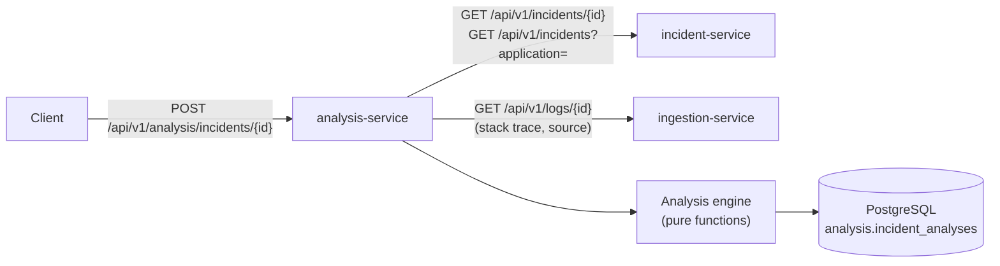

# Incident analysis

analysis-service examines an incident and its error events, detects recurring patterns, finds
related incidents and ranks **potential root causes**, each with supporting evidence, a confidence
level and stated limitations.

The analysis is **deterministic and rule-based**: regular expressions, frequency counts, a
bag-of-words cosine similarity and fixed scoring tables. It uses no machine-learning model and no
external or hosted AI service. The same input always produces the same result, and every result
says which evidence it rests on. Suggested causes are **hypotheses supported by evidence, not
confirmed root causes**; the wording of the results reflects that ("Most likely cause based on
available evidence", "Potential cause").

## Overview



1. **Load** the incident with its most recent events (incident-service returns up to 50), and the
   stack trace and source of the 20 newest events (ingestion-service).
2. **Load the comparison pool**: up to 50 recently active incidents of the same application, in
   any service, environment or status. Events of one incident share a fingerprint, so the details
   of each pool incident's newest event represent it.
3. **Extract features** per event: normalized message, exception chain, stack frames, source.
4. **Analyze**: recurrence, host concentration, errors linked in time or by trace, category rules,
   candidates and confidence, related incidents.
5. **Store** the result as a new revision and return it.

### Why REST instead of reading the other schemas

The service reads incidents and events **only through the public REST APIs** of incident-service
and ingestion-service and writes only to its own `analysis` schema. Phase 3 removed the foreign
keys between the `ingestion` and `incident` schemas; reading those tables directly would bring
the coupling back. The cost is more HTTP calls per analysis (about 1 + 20 for the incident and,
for a pool of N incidents, 1 + 2N more, run up to 8 at a time). That is acceptable for
on-request analysis of one incident; a batch or search endpoint would be needed before analyzing
many incidents at once.

### Why on request, without Kafka

Analysis runs when it is requested (`POST`). Consuming `error-events.v1` as well would re-analyze
an incident on every occurrence and add a second consumer group to the Phase 3 pipeline without
a user-facing benefit yet. A trigger can be added later (for example, analyze when an incident is
created) without changing the engine.

## Normalization

`analysis/normalization.py`. Messages are lower-cased and dynamic values are replaced by typed
placeholders, so that occurrences of the same failure compare as equal:

| Value | Example | Placeholder |
| --- | --- | --- |
| URL query values | `?id=17&lang=en` | `?id=<url-query>&lang=<url-query>` (scheme, host and path kept; fragment dropped) |
| Request/trace/session/transaction IDs | `requestId=req-8f3a9c21` | `request id=<id>` (only when the value contains a digit) |
| UUIDs | `3f2b8c1e-9a4d-…` | `<uuid>` |
| ISO-8601 timestamps, dates, times | `2026-10-14T10:02:11Z`, `2026-10-14`, `10:02:11` | `<timestamp>`, `<date>`, `<time>` |
| Memory addresses, Java identity hashes | `0x7ffd5e8c1a20`, `Session@1b6d3586` | `<address>`, `Session@<address>` |
| IPv4 (with port), full IPv6 | `10.0.3.17:5432` | `<ip>` |
| Hexadecimal tokens of 16+ characters | `9f86d081884c7d65…` | `<hex>` |
| Opaque tokens of 24+ characters with letters and digits | base64/ULID-like strings | `<token>` |
| Other numbers not inside a word | `30000ms`, `HikariPool-1`, `Customer 1234` | `<num>ms`, `hikaripool-<num>`, `customer <num>` |

To avoid making genuinely different failures identical:

- **HTTP status codes are kept** when a 3-digit number follows `http`, `status`, `code`,
  `returned`, `responded` or `response`, or precedes a reason phrase such as
  `Service Unavailable`. `HTTP 401` and `HTTP 503` stay different; `Processed 503 records` does
  not.
- **Digits inside words are kept** (`sha256`, `utf8`, `abc123`).
- **Quoted values are kept** (`Column 'email'` vs `Column 'name'`), as are words such as
  "refused" vs "reset".

Exception names are cleaned (`Caused by:` prefixes, trailing `:`) into a qualified and a simple
name. Source names lose generated-class suffixes (`$$SpringCGLIB$$0`, `$$Lambda$…`, `$1`).

For message comparison, **generic error vocabulary** (`error`, `failed`, `exception`, `unable`,
`could`, `not`, `request`, …) and placeholders are removed, so two messages are not similar just
because both say "failed".

## Stack-trace processing

`analysis/stacktrace.py` supports these formats; any other text yields no frames:

- **Java** (`Throwable.printStackTrace`): `Type: message` header, `at pkg.Class.method(File.java:N)`
  frames, `Native Method`/`Unknown Source`, Java 9+ module prefixes (`java.base/`, `app//`),
  `Caused by:` sections and `... N more` lines. `Suppressed:` sections are skipped.
- **Python** (`traceback` module): `Traceback (most recent call last):`, `File "path", line N, in
  function` frames, the final `Type: message` line and chained tracebacks ("The above exception
  was the direct cause …").

Frames are stored innermost first for both languages, with module/package, class (Java),
function, file and line. **Framework frames** are recognized by a fixed list so that results are
reproducible:

- Java: packages `java.`, `javax.`, `jakarta.`, `jdk.`, `sun.`, `com.sun.`, `org.springframework.`,
  `org.hibernate.`, `org.apache.`, `org.postgresql.`, `com.zaxxer.`, `com.fasterxml.`,
  `tools.jackson.`, `io.netty.`, `reactor.`, `io.jsonwebtoken.`, `okhttp3.`, `feign.` and others
  (see `JAVA_FRAMEWORK_PREFIXES`);
- Python: file paths containing `site-packages`, `dist-packages`, `/lib/python` or `<frozen`.

All other frames are **application frames**. Extracted per event:

| Feature | Definition |
| --- | --- |
| Exception chain | Reported exception type, then every `Caused by` type down to the root cause |
| Top application frames | Up to 5 distinct application frames, starting from the root cause's section; when that section has none (often truncated with `... N more`), the enclosing exceptions' frames follow |
| Top application frame | The first of those: the application code closest to the failure |
| Raised in application code | The root cause's innermost frame is an application frame |
| Component names | Class/module of every frame (framework frames included) plus the event source |

Frames are compared by `Class.method` (Java) or `path:function` (Python), **without line
numbers**, so a recompiled class does not split a pattern.

## Root-cause categories

`analysis/classification.py`. Each category has up to three kinds of rules:

| Kind | Matched against | Points |
| --- | --- | --- |
| `EXCEPTION_TYPE` | Every type in the exception chain | 2 |
| `MESSAGE` | Event message and exception messages, lower-cased (raw, before normalization) | 1 |
| `COMPONENT` | Component names (frames and source). For `APPLICATION_CODE`: the root cause was raised in application code | 1 |

A kind earns its points when it matches in **at least half** of the analyzed events. A category
needs **at least 2 points** to become a candidate.

| Category | Examples of matching evidence |
| --- | --- |
| `DATABASE` | `SQLException`, `PSQLException`, `CannotGetJdbcConnectionException`, `DataAccessResourceFailureException`, psycopg/SQLAlchemy errors; "connection is not available", "HikariPool", "connection to … refused", "deadlock detected"; Hikari/JDBC driver frames, `…Repository`/`…Dao` classes |
| `AUTHENTICATION` | `AuthenticationException`, `AccessDeniedException`, `ExpiredJwtException`, `PermissionError`; "401", "403", "invalid/expired token", "jwt expired", "bad credentials"; Spring Security/JJWT frames, `…TokenValidator`, `…AuthFilter` |
| `SERIALIZATION` | `JsonParseException`, `HttpMessageNotReadableException`, `MismatchedInputException`, `JSONDecodeError`, `NumberFormatException`, `DateTimeParseException`; "JSON parse error", "unexpected character", "cannot deserialize"; Jackson/Gson/pydantic frames |
| `CONFIGURATION` | `BeanCreationException`, `NoSuchBeanDefinitionException`, `ConfigDataException`, `ImproperlyConfigured`; "could not resolve placeholder", "missing required configuration"; Spring `beans`/`context` frames, `…Config`/`…Properties` classes |
| `RESOURCE_EXHAUSTION` | `OutOfMemoryError`, `StackOverflowError`, `RejectedExecutionException`, `MemoryError`; "Java heap space", "too many open files", "no space left on device", "queue full" |
| `TIMEOUT` | Exception types containing `Timeout` (`SocketTimeoutException`, `ReadTimeout`, `TimeoutException`); "timed out", "timeout", "deadline exceeded" |
| `DOWNSTREAM_DEPENDENCY` | `ConnectException`, `UnknownHostException`, `HttpServerErrorException`, `WebClientResponseException`, `FeignException`, `requests.exceptions.ConnectionError`; "502/503/504", "service unavailable", "connection refused", "circuit breaker"; socket/HTTP-client frames, `…Client`/`…Gateway` classes. Also produced by **trace propagation** (below) |
| `APPLICATION_CODE` | `NullPointerException`, `IllegalArgumentException`, `IllegalStateException`, `ClassCastException`, `KeyError`, `AttributeError`, `TypeError`; "cannot invoke … because … is null", "'NoneType' object"; the exception was raised in an application frame |
| `UNKNOWN` | No category reaches 2 points |

When categories have equal points, the order of this table decides the rank (more specific
categories first) and **both are capped at MEDIUM** confidence. Example: a `PSQLException`
caused by a `ConnectException: Connection refused` matches `DATABASE` and
`DOWNSTREAM_DEPENDENCY` equally; the result ranks `DATABASE` first and says that the evidence
does not separate the two.

A custom exception raised in application code without any other matching evidence (for example
`PointsCalculationException`) earns only 1 point and gives `UNKNOWN`, not a guess.

### Trace propagation

If events of this incident share a trace or correlation ID with **earlier** errors (at most 2
minutes before) of another incident in the same environment, the failure probably started there.
This produces a `DOWNSTREAM_DEPENDENCY` candidate titled "Failure propagated from
*&lt;service&gt;* (*&lt;exception&gt;*)", pointing to the other service and its code location.
The incident's own downstream-rule matches (for example "returned 504") are added to it.

## Confidence

Each candidate collects points (maximum 6):

| Signal | Points |
| --- | --- |
| Exception type matches the category rules (in ≥ 50% of events) | +2 |
| Messages match (≥ 50% of events) | +1 |
| Stack frames or source match (≥ 50% of events) | +1 |
| The category's evidence appears in ≥ 80% of ≥ 3 analyzed events | +1 |
| The same top application frame in ≥ 80% of ≥ 2 events with stack traces | +1 |

Trace-propagation candidates instead score: +2 an error in another service precedes this one
within the same trace/correlation ID, +1 the link repeats in ≥ 2 events, +1 it covers ≥ 80% of
the events with IDs, +1 the other incident is itself classified (not `UNKNOWN`), plus this
incident's own downstream-rule points (capped at 6).

| Points | Band |
| --- | --- |
| 5–6 | `HIGH` |
| 3–4 | `MEDIUM` |
| 0–2 | `LOW` |

The band is then **capped** when evidence is incomplete:

| Condition | Maximum |
| --- | --- |
| Single occurrence | `MEDIUM` |
| No stack trace in any analyzed event | `MEDIUM` |
| The exception type does not match the category (evidence from messages/components only) | `MEDIUM` |
| Another candidate has the same score | `MEDIUM` |
| Only one trace links the incident to the earlier error | `MEDIUM` |
| `UNKNOWN` | `LOW` |

Bands are reported instead of percentages because the points are not calibrated probabilities.
Every candidate lists the calculation in `confidenceBasis`, for example:

```text
+2 exception type matches the timeout rules in 4/4 events
+1 messages match the timeout rules in 4/4 events
+1 the same evidence appears in 4/4 analyzed events
+1 same top application frame in 4/4 events with stack traces
= 5 of 6 points: HIGH
```

## Recurring patterns and temporal evidence

`analysis/temporal.py` and `patterns` in the result:

| Pattern | Rule |
| --- | --- |
| `SINGLE` | One occurrence |
| `BURST` | All occurrences within the burst window (15 minutes) |
| `PERSISTENT` | At least 3 occurrences spread over at least 24 hours |
| `RECURRING` | Anything else with more than one occurrence |

The span uses the incident's first/last seen timestamps (all occurrences); the maximum number of
occurrences within the window and the median interval use the analyzed events.

Also reported:

- **dominant exception**, **top application frame** and **repeated frames** with counts;
- **host distribution**: whether all events come from one host;
- **preceding errors**: incidents with events at most 2 minutes before this incident's events.
  `TRACE` links share a trace/correlation ID; `TIME` links are only close in time and are reported
  only when they line up with at least two events and half of the analyzed events;
- **subsequent errors**: the same in the other direction (for example, the checkout failures that
  follow a payment timeout).

No forecasting is done.

## Related incidents

`analysis/similarity.py`. The incident is compared with every incident in the comparison pool.
Each pair earns fixed points per matching signal (capped at 100):

| Signal | Points | Specific? |
| --- | --- | --- |
| Same fingerprint (same error in another environment, or a recurrence after resolution) | 40 | yes |
| Same exception type (qualified name) | 25 | yes |
| Same exception simple name, different package | 15 | yes |
| Shared exception in the cause chain (when the reported types differ) | 10 | yes |
| Same top application frame | 25 | yes |
| Shared application frame (when the top frames differ) | 12 | yes |
| Similar normalized message: `20 × cosine`, if cosine ≥ 0.5 | 10–20 | yes |
| Shared trace/correlation ID (same environment) | 30 | yes |
| Same service | 10 | no |
| Same rule category | 10 | no |
| Overlapping active periods (± 15 minutes) | 10 | no |
| Same source | 5 | no |
| Same environment | 5 | no |

A pair is **related** when the score is at least **40** and at least **20 points come from
specific signals**; `STRONG` from 75 points, `PARTIAL` below. Context signals alone (same
service, category, time, source and environment add up to 40) never relate two incidents, and generic
words never contribute because they are removed before the cosine is computed. The message
cosine is computed over word counts of the event message plus the root-cause exception message.

## Result

`POST /api/v1/analysis/incidents/{id}` returns (see [api.md](api.md#analysis-service-port-8000)
for a full example):

| Field | Content |
| --- | --- |
| `summary` | One sentence: exception, service, recurrence, primary candidate with its band, related-incident count |
| `confidence` | Band of the primary candidate |
| `primaryCandidate`, `candidates` | Ranked candidates (up to 5): `category`, `title`, `confidence`, `score`/`maxScore`, `confidenceBasis`, `explanation`, `evidence` (with counts such as `4/4 events`), `affectedComponent` (service, environment, code location, source), `relatedIncidentIds`, `relatedEventIds`, `limitations` |
| `patterns` | Recurrence, dominant exception, top/repeated frames, source, hosts, preceding/subsequent errors |
| `relatedIncidents` | Up to 10, highest score first, with `matchingSignals` and their points |
| `dataCoverage` | Occurrences, events analyzed, events with details/stack traces, incidents compared |
| `limitations` | What the analysis could not see (truncated history, missing stack traces, no comparison data, …) |
| `analysisVersion`, `revision`, `generatedAt` | Rule version, revision number for this incident, time of analysis |

Event `metadata`, raw payloads and the incident title are not used by the engine.

## Persistence and versioning

Results are stored in `analysis.incident_analyses` (see [database.md](database.md)). Every `POST`
adds a **new revision**; earlier revisions are kept and listed by
`GET /api/v1/analysis/incidents/{id}/history`. `analysisVersion` (currently `1.0.0`) identifies
the rules and scoring; it is increased whenever the same input would produce a different result,
so stored analyses remain interpretable after rule changes.

## Evaluation on synthetic scenarios

`sample-data/analysis-scenarios/` contains 16 labelled scenarios (41 events) written for this
evaluation:

| ID | Scenario | Expected category |
| --- | --- | --- |
| S01 | Payment gateway read timeouts (4 events, 2 hosts) | `TIMEOUT` |
| S02 | Checkout failures in the same traces as S01 | `DOWNSTREAM_DEPENDENCY` |
| S03 | JDBC connection pool exhausted (Hikari) | `DATABASE` |
| S04 | PostgreSQL connection refused (wrapping `ConnectException`) | `DATABASE` |
| S05 | `NullPointerException` in product rendering, over 2 days | `APPLICATION_CODE` |
| S06 | Expired JWT | `AUTHENTICATION` |
| S07 | Malformed JSON request body | `SERIALIZATION` |
| S08 | Python service, HTTP read timeout (chained traceback) | `TIMEOUT` |
| S09 | Python service, `KeyError` in pricing code | `APPLICATION_CODE` |
| S10 | `OutOfMemoryError` in a report job | `RESOURCE_EXHAUSTION` |
| S11 | Unresolved configuration placeholder | `CONFIGURATION` |
| S12 | Carrier API returns 503 | `DOWNSTREAM_DEPENDENCY` |
| S13 | Custom business exception, no recognizable cause | `UNKNOWN` |
| S14 | Same payment timeout as S01, in production | `TIMEOUT` |
| S15 | Refund client timeout (same service and exception as S01, other code path) | `TIMEOUT` |
| S16 | Single export failure without a stack trace | `UNKNOWN` |

Expected related pairs: S01–S02 (shared traces), S01–S14 (same fingerprint), S01–S15 and S14–S15
(same exception and service). Every other pair is expected to be unrelated.

**The labels are kept apart from the runtime input.** `scenarios.json` contains only the events
(with neutral IDs `S01`…`S16`); `labels.json` holds the expected results and is read only by the
evaluation code (`analysis-service/evaluation/`) and its tests, never by the service. A test
checks that no label appears in `scenarios.json`.

Run it:

```bash
cd analysis-service
python -m evaluation            # offline: engine only, no services needed
python -m evaluation --live     # through the running stack: ingestion API -> Kafka ->
                                # incident-service -> analysis API (stores the analyses)
```

**Results** (2026-10-22, analysis version 1.0.0; offline and live runs gave identical results):

| Metric | Result |
| --- | --- |
| Scenarios | 16 |
| Correct primary category | 16/16 |
| Related-incident pairs predicted / expected / correct | 4 / 4 / 4 |
| Related-incident precision | 4/4 |
| Related-incident recall | 4/4 |
| Confidence of the primary candidate | HIGH 9, MEDIUM 5, LOW 2 |

**How to read these numbers.** The scenarios and the rules were written by the same author in
the same phase, and the scenarios exercise exactly the patterns the rules look for. The result
shows that the rules behave as designed on clean, synthetic data; it is **not** a measure of
accuracy on real production incidents, which are noisier, use other libraries and messages, and
often lack stack traces. The set is also too small for meaningful statistics. Its value is as a
regression test: `tests/test_evaluation.py` fails if a rule change alters any of these outcomes.

## Limitations

- **Error events only.** No metrics, traces from a tracing system, deployments or configuration
  are available, so causes outside the application's own error reports (a slow database server,
  an expired certificate, a bad deployment) can only be inferred indirectly.
- **Rule coverage.** The rules recognize common Java/Spring and Python exception types, messages
  and libraries. Other languages, frameworks or custom exception names without telling messages
  give `UNKNOWN` or weaker evidence.
- **Stack-trace formats.** Only Java and Python traces are parsed (see above).
- **Correlation is not causation.** Shared trace IDs show that requests are connected; time
  proximity is weaker still. Both are reported as evidence, never as proof.
- **Bounded data.** At most the 50 most recent events of an incident (incident-service limit),
  stack traces of the 20 newest, and 50 incidents of the same application for comparison.
- **Fixed weights.** Points and thresholds were chosen by hand to be explainable; they are not
  fitted to data.
