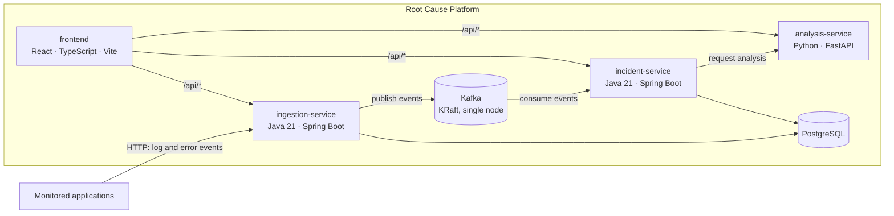

# Architecture

This document describes the target architecture and marks which parts exist today.

## Components

| Component | Responsibility (target) | Implemented in Phase 1 |
| --- | --- | --- |
| `ingestion-service` | Accept, validate and persist log events; publish them to Kafka | Application skeleton, Actuator health and info endpoints |
| `incident-service` | Fingerprint errors, group them into incidents, detect recurring failures | Application skeleton, Actuator health and info endpoints |
| `analysis-service` | Analyze incidents and rank likely root causes with supporting evidence | FastAPI application with `GET /health` |
| `frontend` | Dashboard for overview, error monitoring, root cause analysis and service health | Layout and navigation; live service health page; other pages are starter layouts |
| PostgreSQL | Durable storage, one schema per service | Container with `ingestion` and `incident` schemas, no tables |
| Kafka | Event stream between ingestion and incident processing | Single-node KRaft broker, no topics |

Phase 1 services do not connect to PostgreSQL or Kafka yet. Those connections are added together
with the features that need them, so each phase can be tested end to end.

## Request routing

The browser only talks to the frontend origin. Calls to `/api/<service>/...` are forwarded to the
matching backend with the prefix removed:

| Browser path | Forwarded to |
| --- | --- |
| `/api/ingestion/*` | `ingestion-service:8081/*` |
| `/api/incident/*` | `incident-service:8082/*` |
| `/api/analysis/*` | `analysis-service:8000/*` |

In Docker this is done by nginx (`frontend/nginx.conf`); during `npm run dev` by the Vite dev
server proxy (`frontend/vite.config.ts`). This avoids CORS configuration in the services and keeps
the dashboard deployable as static files.

## Health checks

| Component | Endpoint / command | Used by |
| --- | --- | --- |
| ingestion-service | `GET /actuator/health`, `/actuator/health/liveness`, `/actuator/health/readiness` | Compose health check (readiness), dashboard |
| incident-service | same as above on port 8082 | Compose health check (readiness), dashboard |
| analysis-service | `GET /health` | Compose health check, dashboard |
| frontend | `GET /` | Compose health check |
| PostgreSQL | `pg_isready` | Compose health check |
| Kafka | `kafka-broker-api-versions.sh` | Compose health check |

## Kafka listeners

The broker runs in combined broker + controller mode (KRaft) with three listeners:

- `INTERNAL://kafka:29092` for containers on the Compose network,
- `EXTERNAL://localhost:9092` for clients on the host machine (for example, tests run from an IDE),
- `CONTROLLER://:9093` for the KRaft controller quorum.
