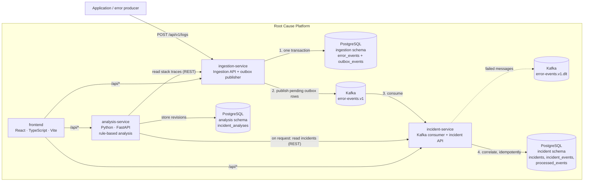

# Architecture

This document describes the target architecture and marks which parts exist today.

## Components

All three schemas live in the same PostgreSQL database (see [database.md](database.md#design-notes)).
Event flow, contract and guarantees are described in [events.md](events.md).

| Component | Responsibility (target) | Implemented so far (Phase 4) |
| --- | --- | --- |
| `ingestion-service` | Accept, validate and persist log events; publish them to Kafka | REST API to store and read events, application registration, error fingerprinting, transactional outbox and Kafka publisher, `ingestion` schema migrations |
| `incident-service` | Group errors into incidents automatically, detect recurring failures | Kafka consumer that correlates events into incidents (idempotent, with retries and a dead-letter topic), REST API to list/filter and retrieve incidents, deprecated manual creation, `incident` schema migrations |
| `analysis-service` | Analyze incidents and rank likely root causes with supporting evidence | Rule-based analysis API: normalization, Java/Python stack-trace parsing, recurrence and trace-linked errors, related incidents, ranked potential causes with evidence and confidence bands; stores revisions in the `analysis` schema. See [analysis.md](analysis.md) |
| `frontend` | Dashboard for overview, error monitoring, root cause analysis and service health | Layout and navigation; live service health page; other pages are not connected to the APIs yet |
| PostgreSQL | Durable storage, one schema per service | Seven tables across the `ingestion`, `incident` and `analysis` schemas, no foreign keys between them |
| Kafka | Event stream between ingestion and incident processing | Single-node KRaft broker with `error-events.v1` and its dead-letter topic, 3 partitions each |

Recurring failures are detected deterministically: repeated occurrences of the same fingerprint
in the same application increase one incident's occurrence count. analysis-service then analyzes
an incident on request: it reads the incident and its events through the incident and ingestion
APIs (never their tables), applies documented rules and scores, and stores the result as a new
revision. The analysis is deterministic and does not use machine learning or external AI
services; its suggestions are potential causes with evidence, not confirmed root causes.

## Service internals

Both Spring Boot services follow the same layered structure:

| Package | Contents |
| --- | --- |
| `api` | REST controllers, request/response DTOs (Java records), `GlobalExceptionHandler` |
| `service` | Business logic and transaction boundaries (`@Transactional`) |
| `domain` | JPA entities and Spring Data repositories |
| `logging` | `CorrelationIdFilter`: correlation ID and one log line per API request |
| `messaging` | Kafka topic configuration and the message contract (`ErrorEventCreated`); in incident-service also the listener, message validation and the retry/dead-letter error handler |
| `outbox` | ingestion-service only: outbox table access, publisher and its scheduler |

Controllers never return JPA entities; they map them to DTOs. Request DTOs are validated with
Jakarta Bean Validation, and all errors are converted to RFC 9457 problem details by
`GlobalExceptionHandler` (see [api.md](api.md#errors)). The two services share no code: each is
built and deployed on its own, so the few small shared classes (exception handler, filter) are
duplicated deliberately.

analysis-service (Python, FastAPI) is organized the same way:

| Package | Contents |
| --- | --- |
| `api` | Routes, RFC 9457 problem details (same shape as the Spring services), correlation ID middleware |
| `services` | Use cases: load the incident and comparison pool, run the engine, store and log the result |
| `analysis` | The engine as pure functions: `normalization`, `stacktrace`, `features`, `classification`, `temporal`, `similarity`, `candidates`, `confidence`, `engine` |
| `clients` | Read-only HTTP clients for the incident and ingestion APIs (forward `X-Correlation-Id`) |
| `repositories` | Connection pool, SQL migrations of the `analysis` schema, analysis storage |
| `models` | Input records and the result model (camelCase JSON) |

## Logging

- In Docker, `LOGGING_STRUCTURED_FORMAT_CONSOLE=ecs` makes Spring Boot write one JSON object per
  line in [Elastic Common Schema](https://www.elastic.co/guide/en/ecs/current/index.html) format;
  analysis-service does the same with `LOG_FORMAT=json`, using the same ECS field names.
  Locally the services log plain text with the same fields appended as `key="value"` pairs.
- Every request gets a correlation ID (from the `X-Correlation-Id` header or generated). It is
  added to every log record of that request and returned in the response header and in error
  responses.
- Business events are logged with an `action` field and identifiers, for example
  `action=log.ingest` with `eventId`, `applicationId`, `serviceName`, `fingerprint` and the
  event's own `eventTraceId`/`eventCorrelationId`, or `action=incident.create` with `incidentId`
  and `eventCount`. API requests are logged with method, path, status and duration.
- Kafka processing is logged with the topic, partition, offset, event ID, application ID,
  fingerprint and incident ID: `action=outbox.publish` / `outbox.publish_failed` (with `attempt`,
  `nextAttemptAt` and the root cause) in ingestion-service, and `action=event.correlate` (with the
  `outcome`), `event.process_failed` (with `deliveryAttempt`) and `event.dead_letter` in
  incident-service. The HTTP request's correlation ID travels in the `correlation-id` Kafka
  header, so one ID connects the API call, the publication and the incident update.
- analysis-service logs `action=analysis.start`, `analysis.complete` (with `incidentId`,
  `analysisId`, `revision`, `eventsAnalyzed`, `eventsWithStackTrace`, `incidentsCompared`,
  `candidateCount`, `primaryCategory`, `confidence`, `relatedIncidentCount`, `durationMs`) and
  `analysis.failed` (with `failureReason`), plus `backend.unavailable` and `db.unavailable`. It
  forwards the request's `X-Correlation-Id` to incident-service and ingestion-service, so their
  request logs carry the same ID.
- Log messages, stack traces and request bodies are not logged, since they may contain user
  data. Database credentials are never logged. analysis-service writes a stack trace only for
  unexpected errors (`http.unexpected_error`, HTTP 500).

## Request routing

The browser only talks to the frontend origin. Calls to `/api/<service>/...` are forwarded to the
matching backend with the prefix removed:

| Browser path | Forwarded to |
| --- | --- |
| `/api/ingestion/*` | `ingestion-service:8081/*` |
| `/api/incident/*` | `incident-service:8082/*` |
| `/api/analysis/*` | `analysis-service:8000/*` |

In Docker this is done by nginx (`frontend/nginx.conf`); during `npm run dev` by the Vite dev
server proxy (`frontend/vite.config.ts`). This avoids CORS configuration in the services and keeps
the dashboard deployable as static files.

## Health checks

| Component | Endpoint / command | Used by |
| --- | --- | --- |
| ingestion-service | `GET /actuator/health`, `/actuator/health/liveness`, `/actuator/health/readiness` (readiness includes the database connection) | Compose health check (readiness), dashboard |
| incident-service | same as above on port 8082 | Compose health check (readiness), dashboard |
| analysis-service | `GET /health` (liveness), `GET /health/readiness` (database connection) | Compose health check (readiness), dashboard (liveness) |
| frontend | `GET /` | Compose health check |
| PostgreSQL | `pg_isready` | Compose health check |
| Kafka | `kafka-broker-api-versions.sh` | Compose health check |

Readiness of both Spring Boot services includes the database but **not Kafka**, and liveness
depends on neither:

- ingestion-service keeps accepting events while Kafka is down (they wait in the outbox), so it
  should stay in rotation.
- incident-service can still serve its REST API without Kafka; its consumer resumes on its own
  when the broker returns.

A Kafka outage is visible instead through `outbox.publish_failed` log lines, the pending rows in
`ingestion.outbox_events` and consumer lag.

analysis-service readiness includes only its database. incident-service and ingestion-service are
needed only while an analysis is requested; if either is down, that request fails with `503` and
stored analyses can still be read. Nothing in the Phase 3 pipeline depends on analysis-service.

## Kafka listeners

The broker runs in combined broker + controller mode (KRaft) with three listeners:

- `INTERNAL://kafka:29092` for containers on the Compose network,
- `EXTERNAL://localhost:9092` for clients on the host machine (for example, tests run from an IDE),
- `CONTROLLER://:9093` for the KRaft controller quorum.
