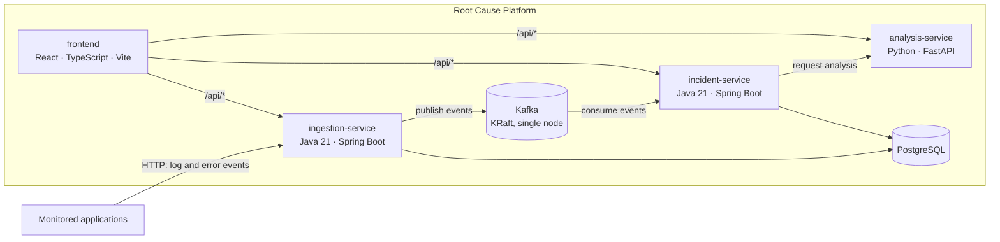

# Architecture

This document describes the target architecture and marks which parts exist today.

## Components

| Component | Responsibility (target) | Implemented so far (Phase 2) |
| --- | --- | --- |
| `ingestion-service` | Accept, validate and persist log events; publish them to Kafka | REST API to store and read events, application registration, error fingerprinting, `ingestion` schema migrations |
| `incident-service` | Group errors into incidents automatically, detect recurring failures | REST API to create incidents from stored events, list/filter and retrieve them, `incident` schema migrations |
| `analysis-service` | Analyze incidents and rank likely root causes with supporting evidence | FastAPI application with `GET /health` |
| `frontend` | Dashboard for overview, error monitoring, root cause analysis and service health | Layout and navigation; live service health page; other pages are not connected to the APIs yet |
| PostgreSQL | Durable storage, one schema per service | Four tables across the `ingestion` and `incident` schemas, see [database.md](database.md) |
| Kafka | Event stream between ingestion and incident processing | Single-node KRaft broker, not used by the services yet |

In Phase 2, incident-service reads the events that ingestion-service stores in the shared
database, and incidents are created through an explicit API call. Publishing events to Kafka and
correlating them into incidents automatically are planned for Phase 3.

## Service internals

Both Spring Boot services follow the same layered structure:

| Package | Contents |
| --- | --- |
| `api` | REST controllers, request/response DTOs (Java records), `GlobalExceptionHandler` |
| `service` | Business logic and transaction boundaries (`@Transactional`) |
| `domain` | JPA entities and Spring Data repositories |
| `logging` | `CorrelationIdFilter`: correlation ID and one log line per API request |

Controllers never return JPA entities; they map them to DTOs. Request DTOs are validated with
Jakarta Bean Validation, and all errors are converted to RFC 9457 problem details by
`GlobalExceptionHandler` (see [api.md](api.md#errors)). The two services share no code: each is
built and deployed on its own, so the few small shared classes (exception handler, filter) are
duplicated deliberately.

## Logging

- In Docker, `LOGGING_STRUCTURED_FORMAT_CONSOLE=ecs` makes Spring Boot write one JSON object per
  line in [Elastic Common Schema](https://www.elastic.co/guide/en/ecs/current/index.html) format.
  Locally the services log plain text with the same fields appended as `key="value"` pairs.
- Every request gets a correlation ID (from the `X-Correlation-Id` header or generated). It is
  added to every log record of that request and returned in the response header and in error
  responses.
- Business events are logged with an `action` field and identifiers, for example
  `action=log.ingest` with `eventId`, `applicationId`, `serviceName`, `fingerprint` and the
  event's own `eventTraceId`/`eventCorrelationId`, or `action=incident.create` with `incidentId`
  and `eventCount`. API requests are logged with method, path, status and duration.
- Log messages, stack traces and request bodies are not logged, since they may contain user
  data. Database credentials are never logged.

## Request routing

The browser only talks to the frontend origin. Calls to `/api/<service>/...` are forwarded to the
matching backend with the prefix removed:

| Browser path | Forwarded to |
| --- | --- |
| `/api/ingestion/*` | `ingestion-service:8081/*` |
| `/api/incident/*` | `incident-service:8082/*` |
| `/api/analysis/*` | `analysis-service:8000/*` |

In Docker this is done by nginx (`frontend/nginx.conf`); during `npm run dev` by the Vite dev
server proxy (`frontend/vite.config.ts`). This avoids CORS configuration in the services and keeps
the dashboard deployable as static files.

## Health checks

| Component | Endpoint / command | Used by |
| --- | --- | --- |
| ingestion-service | `GET /actuator/health`, `/actuator/health/liveness`, `/actuator/health/readiness` (readiness includes the database connection) | Compose health check (readiness), dashboard |
| incident-service | same as above on port 8082 | Compose health check (readiness), dashboard |
| analysis-service | `GET /health` | Compose health check, dashboard |
| frontend | `GET /` | Compose health check |
| PostgreSQL | `pg_isready` | Compose health check |
| Kafka | `kafka-broker-api-versions.sh` | Compose health check |

## Kafka listeners

The broker runs in combined broker + controller mode (KRaft) with three listeners:

- `INTERNAL://kafka:29092` for containers on the Compose network,
- `EXTERNAL://localhost:9092` for clients on the host machine (for example, tests run from an IDE),
- `CONTROLLER://:9093` for the KRaft controller quorum.
