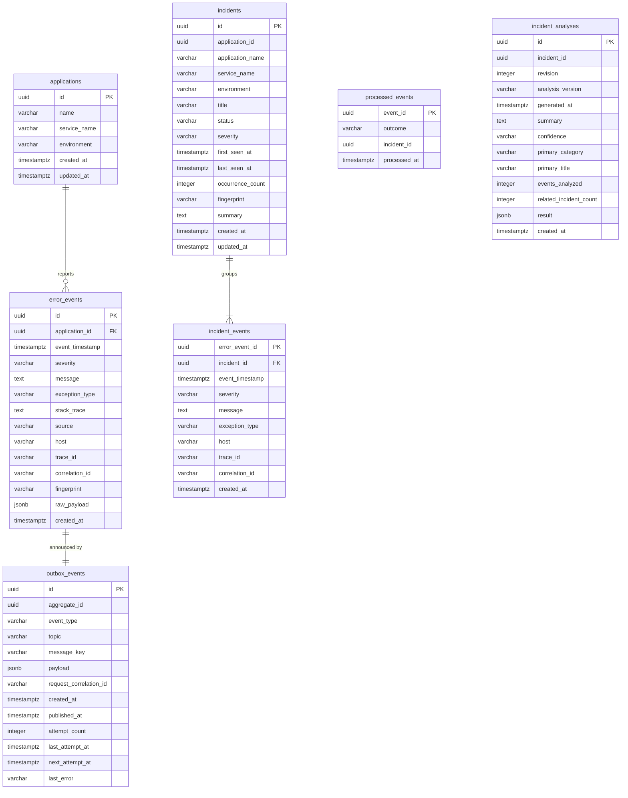

# Database model

PostgreSQL 17, one database with a schema per service. Each service creates and evolves its own
schema with versioned SQL migrations that run when the service starts:
[Flyway](https://documentation.red-gate.com/flyway) in the Spring Boot services and a small
runner with the same file naming in analysis-service.

| Schema | Owner | Tables | Migrations |
| --- | --- | --- | --- |
| `ingestion` | ingestion-service | `applications`, `error_events`, `outbox_events` | `backend/ingestion-service/src/main/resources/db/migration/` |
| `incident` | incident-service | `incidents`, `incident_events`, `processed_events` | `backend/incident-service/src/main/resources/db/migration/` |
| `analysis` | analysis-service | `incident_analyses` | `analysis-service/src/analysis_service/repositories/migrations/` |

The `ingestion` and `incident` schemas also contain Flyway's `flyway_schema_history` table, the
`analysis` schema the equivalent `schema_migrations` table (version, description, SHA-256
checksum; analysis-service refuses to start if an applied migration file was changed). Hibernate
runs with
`ddl-auto: validate`, so a service refuses to start if its entities and the migrated schema
disagree. Applied migrations are never edited; changes are made with new migrations.

| Migration | Phase | Change |
| --- | --- | --- |
| `ingestion` V1 | 2 | `applications`, `error_events` |
| `ingestion` V2 | 3 | `outbox_events` (transactional outbox) |
| `ingestion` V3 | 5 | Indexes for listing events newest first and counting recently received events |
| `incident` V1 | 2 | `incidents`, `incident_events`, with foreign keys into the `ingestion` schema |
| `incident` V2 | 3 | Copies application and event details into the incident tables, drops the foreign keys into `ingestion`, adds `processed_events` |
| `analysis` V1 | 4 | `incident_analyses` |



The schemas are not connected by foreign keys. `incidents.application_id`,
`incident_events.error_event_id` and `processed_events.event_id` hold ingestion-side IDs taken
from Kafka messages; `incident_analyses.incident_id` holds an incident-service ID.

## Tables

### `ingestion.applications`

A monitored application, identified by `(name, service_name, environment)`, for example
`("demo-shop", "payment-service", "staging")`. Rows are created by ingestion-service with
`INSERT ... ON CONFLICT DO NOTHING`, so simultaneous first events for a new application create
exactly one row.

### `ingestion.error_events`

One row per received log or error event. `raw_payload` (JSONB) keeps the accepted request,
including the free-form `metadata` object. `fingerprint` is a 64-character SHA-256 hex digest;
see [API reference](api.md#fingerprints).

### `ingestion.outbox_events`

One row per Kafka message to publish, written in the same transaction as the error event
(`aggregate_id`). `payload` is the `ErrorEventCreated` message, `request_correlation_id` is sent
as a Kafka header. `published_at` stays `NULL` until Kafka has acknowledged the message;
`attempt_count`, `last_attempt_at`, `next_attempt_at` and `last_error` track retries. Published
rows are deleted after 7 days. See [events.md](events.md#reliable-publishing-transactional-outbox).

### `incident.incidents`

A group of error events with the same application and fingerprint. `status` is `OPEN`,
`INVESTIGATING` or `RESOLVED`. `occurrence_count`, `first_seen_at` and `last_seen_at` summarize
the linked events. The application's ID, name, service and environment are stored on the
incident, so incident-service never needs to read the ingestion schema to display it.

### `incident.incident_events`

The events of an incident, with the details shown in the incident API. Keyed by the error event
ID, so an event belongs to at most one incident. Deleting an incident removes its links
(`ON DELETE CASCADE`).

### `incident.processed_events`

One row per consumed `ErrorEventCreated` message, written in the same transaction as the incident
change. `outcome` is `INCIDENT_CREATED`, `INCIDENT_UPDATED`, `IGNORED_SEVERITY` or
`ALREADY_ASSIGNED`. A message whose `event_id` is already present is skipped; this is what makes
the consumer idempotent. See [events.md](events.md#idempotency).

### `analysis.incident_analyses`

One row per analysis of an incident. Every `POST /api/v1/analysis/incidents/{id}` adds a row with
the next `revision` for that incident; earlier revisions are kept as history. `result` (JSONB)
holds the complete result exactly as the API returns it (candidates, evidence, patterns, related
incidents, limitations). `summary`, `confidence`, `primary_category`, `primary_title`,
`events_analyzed` and `related_incident_count` repeat its key values as columns for listing and
querying. `analysis_version` identifies the rules that produced the result. Related incidents are
kept inside `result` rather than in a separate table, because they are only read together with
their analysis. Concurrent analyses of the same incident are serialized with a transaction-level
advisory lock, so revisions stay sequential.

## Integrity rules

| Rule | Enforced by |
| --- | --- |
| An application is unique per name, service and environment | `uq_applications_name_service_environment` |
| Severity is one of the five known levels | `ck_error_events_severity`, `ck_incidents_severity`, `ck_incident_events_severity` |
| Fingerprints are 64 lowercase hex characters | `ck_error_events_fingerprint` |
| Incident status is one of the three known values | `ck_incidents_status` |
| An incident has at least one occurrence, and `first_seen_at <= last_seen_at` | `ck_incidents_occurrence_count`, `ck_incidents_seen_order` |
| At most one unresolved incident per application and fingerprint | Partial unique index `uq_incidents_active_fingerprint` (`WHERE status <> 'RESOLVED'`) |
| An error event belongs to at most one incident | Primary key of `incident_events` |
| A Kafka message is processed at most once | Primary key of `processed_events` |
| Outbox retry counts are never negative | `ck_outbox_events_attempt_count` |
| One row per incident and analysis revision; revisions start at 1 | `uq_incident_analyses_incident_revision`, `ck_incident_analyses_revision` |
| Analysis confidence is `LOW`, `MEDIUM` or `HIGH` | `ck_incident_analyses_confidence` |

## Indexes

| Index | Supports |
| --- | --- |
| `ix_error_events_application_timestamp` | Recent events per application |
| `ix_error_events_fingerprint` | All occurrences of the same error |
| `ix_error_events_trace_id`, `ix_error_events_correlation_id` | Following a request across services (partial: only rows with a value) |
| `ix_outbox_events_pending` | The publisher's poll for due messages (partial: unpublished rows only) |
| `ix_outbox_events_aggregate_id` | Finding the message for an error event |
| `ix_error_events_event_timestamp` | Event list across all applications, newest first (`GET /api/v1/logs`) |
| `ix_error_events_created_at` | Events received in the last hours (`GET /api/v1/logs/activity`) |
| `ix_incidents_status_severity` | Filtering the incident list |
| `ix_incidents_last_seen_at` | Ordering the incident list |
| `ix_incidents_application_id` | Incidents per application |
| `ix_incident_events_incident_timestamp` | An incident's most recent events |
| `uq_incident_analyses_incident_revision` | Latest analysis and history of an incident |
| `ix_incident_analyses_primary_category` | Analyses by suggested category, newest first |

## Design notes

- **Separate schemas, no cross-schema foreign keys.** Since Phase 3, incident-service builds its
  data from Kafka messages and never needs ingestion tables to correlate or display incidents.
  Incident `V2` copied the details of existing Phase 2 incidents from the ingestion schema before
  dropping the foreign keys, so no data was lost.
- **Remaining shared-database coupling**, stated honestly:
  - Both services still use the same PostgreSQL server and database (with separate schemas and
    the same local credentials). A separate database per service would not change the code, only
    the connection settings.
  - The deprecated `POST /api/v1/incidents` endpoint still reads `ingestion.error_events` for
    compatibility. It goes away together with that endpoint.
  - On a brand-new database, incident `V1` (from Phase 2, not editable) still references the
    ingestion tables, so ingestion-service must have migrated first. Docker Compose ensures this
    by starting incident-service after ingestion-service is healthy.
- **analysis-service reads no other schema.** It gets incidents and events through the incident
  and ingestion REST APIs and writes only to `analysis`. See
  [analysis.md](analysis.md#why-rest-instead-of-reading-the-other-schemas).
- **UUID keys.** Error events, outbox messages and incidents use time-ordered UUIDs (version 7)
  generated by the application, which keeps primary key inserts sequential. Applications and
  stored analyses use PostgreSQL's `gen_random_uuid()`.
- **Statuses and severities as checked `varchar`** rather than PostgreSQL enum types, which are
  harder to change in later migrations.

## Inspecting the database

```bash
docker compose exec postgres psql -U rootcause -d rootcause
```

```sql
\dt ingestion.*
\dt incident.*
\dt analysis.*
SELECT version, description, success FROM incident.flyway_schema_history;

-- Outbox: pending messages and retries
SELECT count(*) FILTER (WHERE published_at IS NULL) AS pending, max(attempt_count) AS max_attempts
FROM ingestion.outbox_events;

-- Stored analyses: latest revision per incident
SELECT DISTINCT ON (incident_id) incident_id, revision, confidence, primary_category, primary_title
FROM analysis.incident_analyses ORDER BY incident_id, revision DESC;
SELECT version, description, applied_at FROM analysis.schema_migrations;

-- Incidents created by the consumer, with what happened to each message
SELECT outcome, count(*) FROM incident.processed_events GROUP BY outcome;
SELECT service_name, occurrence_count, status, first_seen_at, last_seen_at
FROM incident.incidents ORDER BY last_seen_at DESC;
```
