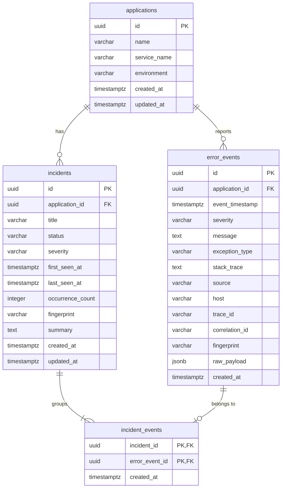

# Database model

PostgreSQL 17, one database with a schema per backend service. Each service creates and evolves
its own schema with [Flyway](https://documentation.red-gate.com/flyway) migrations that run when
the service starts.

| Schema | Owner | Tables | Migrations |
| --- | --- | --- | --- |
| `ingestion` | ingestion-service | `applications`, `error_events` | `backend/ingestion-service/src/main/resources/db/migration/` |
| `incident` | incident-service | `incidents`, `incident_events` | `backend/incident-service/src/main/resources/db/migration/` |

Each schema also contains Flyway's `flyway_schema_history` table. Hibernate runs with
`ddl-auto: validate`, so a service refuses to start if its entities and the migrated schema
disagree.



## Tables

### `ingestion.applications`

A monitored application, identified by `(name, service_name, environment)`, for example
`("demo-shop", "payment-service", "staging")`. Rows are created by ingestion-service with
`INSERT ... ON CONFLICT DO NOTHING`, so simultaneous first events for a new application create
exactly one row.

### `ingestion.error_events`

One row per received log or error event. `raw_payload` (JSONB) keeps the accepted request,
including the free-form `metadata` object. `fingerprint` is a 64-character SHA-256 hex digest;
see [API reference](api.md#fingerprints).

### `incident.incidents`

A group of error events with the same application and fingerprint. `status` is `OPEN`,
`INVESTIGATING` or `RESOLVED`. `occurrence_count`, `first_seen_at` and `last_seen_at` summarize
the linked events.

### `incident.incident_events`

Links incidents to error events. Deleting an incident removes its links (`ON DELETE CASCADE`);
error events themselves are never deleted through incidents.

## Integrity rules

| Rule | Enforced by |
| --- | --- |
| An application is unique per name, service and environment | `uq_applications_name_service_environment` |
| Severity is one of the five known levels | `ck_error_events_severity`, `ck_incidents_severity` |
| Fingerprints are 64 lowercase hex characters | `ck_error_events_fingerprint` |
| Incident status is one of the three known values | `ck_incidents_status` |
| An incident has at least one occurrence, and `first_seen_at <= last_seen_at` | `ck_incidents_occurrence_count`, `ck_incidents_seen_order` |
| At most one unresolved incident per application and fingerprint | Partial unique index `uq_incidents_active_fingerprint` (`WHERE status <> 'RESOLVED'`) |
| An error event belongs to at most one incident | `uq_incident_events_error_event` |
| Events and incidents reference existing applications and events | Foreign keys |

## Indexes

| Index | Supports |
| --- | --- |
| `ix_error_events_application_timestamp` | Recent events per application |
| `ix_error_events_fingerprint` | All occurrences of the same error |
| `ix_error_events_trace_id`, `ix_error_events_correlation_id` | Following a request across services (partial: only rows with a value) |
| `ix_incidents_status_severity` | Filtering the incident list |
| `ix_incidents_last_seen_at` | Ordering the incident list |
| `ix_incidents_application_id` | Incidents per application |

## Design notes

- **Shared database, separate schemas.** Incident tables have foreign keys into the `ingestion`
  schema, and incident-service reads (never writes) `applications` and `error_events`. This keeps
  the current phase simple and consistent. In Docker Compose, incident-service waits for
  ingestion-service to become healthy, which guarantees the ingestion migrations ran first.
  Streaming events between the services through Kafka is planned for a later phase.
- **UUID keys.** Error events and incidents use time-ordered UUIDs (version 7) generated by the
  application, which keeps primary key inserts sequential. Applications use PostgreSQL's
  `gen_random_uuid()`.
- **Statuses and severities as checked `varchar`** rather than PostgreSQL enum types, which are
  harder to change in later migrations.

## Inspecting the database

```bash
docker compose exec postgres psql -U rootcause -d rootcause
```

```sql
\dt ingestion.*
\dt incident.*
SELECT version, description, success FROM ingestion.flyway_schema_history;
SELECT a.service_name, e.severity, left(e.fingerprint, 12) AS fingerprint, count(*)
FROM ingestion.error_events e JOIN ingestion.applications a ON a.id = e.application_id
GROUP BY 1, 2, 3 ORDER BY 1;
```
