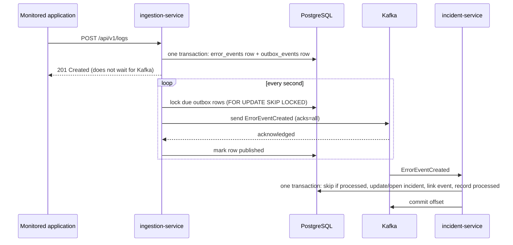

# Events

The services communicate through Apache Kafka. This document describes the topics, the message
contract and the delivery guarantees.

## Flow



## Topics

| Topic | Partitions | Producer | Consumer | Purpose |
| --- | --- | --- | --- | --- |
| `error-events.v1` | 3 | ingestion-service | incident-service (group `incident-service`) | One message per stored log event |
| `error-events.v1.dlt` | 3 | incident-service | — (inspected manually) | Messages incident-service could not process |

- Names are configurable (`KAFKA_TOPIC_ERROR_EVENTS`, `KAFKA_TOPIC_ERROR_EVENTS_DLT`). The `.v1`
  suffix is the contract version: an incompatible change gets a new topic, so old and new
  consumers can run side by side during a migration.
- The services create the topics at startup. Automatic topic creation in the broker is disabled,
  so a mistyped topic name fails instead of silently creating a single-partition topic.
- **Why 3 partitions:** incident-service runs one consumer thread per partition, and the count
  allows scaling to three consumer instances later. Adding partitions afterwards would move keys
  to other partitions, so the number is chosen up front.

### Message key

The key is `<applicationId>:<fingerprint>`, for example
`fb6ee99c-6841-4acb-b651-683d87993cae:1768a03e1bfb…`.

All occurrences of the same error in the same application therefore go to the same partition and
are processed in order, one at a time, by one consumer thread. Updates to one incident never race
each other, while different errors are processed in parallel. Correlation does not rely on this
ordering for correctness (first/last seen are computed from event timestamps), but it avoids
contention on the same incident row.

## `ErrorEventCreated` version 1

Published by ingestion-service for **every** stored log event, regardless of severity.
incident-service decides what to correlate.

Example (also used as a contract fixture by the tests of both services):
[`events/error-event-created.v1.example.json`](events/error-event-created.v1.example.json)

```json
{
  "eventType": "ErrorEventCreated",
  "eventVersion": 1,
  "errorEventId": "01a159ed-2f0a-73d1-94f9-a9b84bbb1a00",
  "occurredAt": "2026-10-20T15:27:58.731355Z",
  "application": {
    "id": "fb6ee99c-6841-4acb-b651-683d87993cae",
    "name": "demo-shop",
    "service": "payment-service",
    "environment": "staging"
  },
  "eventTimestamp": "2026-10-12T09:14:05.402Z",
  "severity": "ERROR",
  "exceptionType": "java.net.SocketTimeoutException",
  "message": "Payment authorization failed",
  "fingerprint": "1768a03e1bfbe239bfe6ea3ee3ae7495a804729552f3187a69f7515444348ae7",
  "traceId": "4bf92f3577b34da6a3ce929d0e0e4736",
  "correlationId": null,
  "source": "com.shop.payment.GatewayClient",
  "host": "payment-5d8b7-fghij"
}
```

| Field | Type | Required | Description |
| --- | --- | --- | --- |
| `eventType` | string | yes | Always `ErrorEventCreated` |
| `eventVersion` | integer | yes | Always `1` for this contract |
| `errorEventId` | UUID | yes | ID of the stored event in ingestion-service; the idempotency key |
| `occurredAt` | timestamp | yes | When ingestion-service stored the event (and created the message) |
| `application.id` | UUID | yes | Application ID in ingestion-service |
| `application.name`, `.service`, `.environment` | string | yes | Lower-case application identity |
| `eventTimestamp` | timestamp | yes | When the event happened, as reported by the application |
| `severity` | string | yes | `DEBUG`, `INFO`, `WARN`, `ERROR` or `FATAL` |
| `exceptionType` | string | no | Exception class name |
| `message` | string | yes | Log message |
| `fingerprint` | string | yes | 64 hex characters, see [api.md](api.md#fingerprints) |
| `traceId`, `correlationId` | string | no | The application's own trace and correlation IDs |
| `source`, `host` | string | no | Logger/component and host name |

Optional fields are always present, with `null` when there is no value. Timestamps are ISO-8601
in UTC. Field order is not significant (the outbox stores payloads as PostgreSQL `jsonb`, which
reorders keys).

**Deliberately excluded:** stack traces, the free-form `metadata` object and the raw request
payload. They stay in ingestion-service's database; consumers that need them can fetch the event
with `GET /api/v1/logs/{errorEventId}`. No credentials or secrets are ever part of a message.

### Headers

| Header | Example | Description |
| --- | --- | --- |
| `event-type` | `ErrorEventCreated` | Same as `eventType`, for routing without parsing |
| `event-version` | `1` | Same as `eventVersion` |
| `correlation-id` | `kafka-outage-test` | Correlation ID of the HTTP request that stored the event; incident-service logs it with every line about the message |
| `published-at` | `2026-10-20T16:31:15.25Z` | When the message was handed to the Kafka producer |

### Compatibility rules

- Consumers ignore unknown fields, so new **optional** fields can be added to version 1.
- Removing or renaming a field, changing a type or the meaning of a field requires version 2 on a
  new topic (`error-events.v2`).
- incident-service rejects messages with any other `eventType` or `eventVersion` (they go to the
  dead-letter topic).

## Reliable publishing: transactional outbox

ingestion-service never sends to Kafka inside the HTTP request. Instead:

1. `POST /api/v1/logs` stores the event **and** an `outbox_events` row in the same PostgreSQL
   transaction, then returns `201`. Either both rows exist or neither does.
2. A background publisher polls every second for due, unpublished rows (oldest first, at most 50
   per round), locking them with `FOR UPDATE SKIP LOCKED` so several instances could share the
   work.
3. Each message is sent and the publisher waits for Kafka's acknowledgement (`acks=all`,
   idempotent producer). Only then is the row marked `published_at`.
4. On failure the row stays pending: `attempt_count` increases, `last_error` records the root
   cause (no stack trace) and `next_attempt_at` is pushed out with exponential backoff
   (1 s, 2 s, 4 s … up to 60 s). The round stops at the first failure, because when Kafka is down
   every further send would also time out.

Retries are bounded in frequency and batch size, but deliberately **not in count**: giving up
would lose an event that is already stored. Every 10th failed attempt of the same message is
logged at `ERROR` to make stuck delivery visible. Published rows are deleted after 7 days.

**Guarantee:** at-least-once. If the service stops between Kafka's acknowledgement and the
database commit, the message is sent again after restart. The consumer is idempotent for this
reason.

## Consumer: correlation, idempotency, failures

### Correlation rules

For each valid message incident-service runs one database transaction:

1. **Duplicate?** If the `errorEventId` is in `processed_events`, the message was processed before.
   Nothing changes.
2. **Below threshold?** Events below `ERROR` (configurable) are recorded as `IGNORED_SEVERITY` and
   create no incident.
3. **Already assigned?** If the event was attached to an incident through the deprecated manual
   endpoint, it is recorded as `ALREADY_ASSIGNED`.
4. Otherwise, find the **unresolved** (`OPEN` or `INVESTIGATING`) incident with the same
   application ID and fingerprint, locking it:
   - none: open a new `OPEN` incident with `occurrenceCount = 1` and first/last seen set to the
     event timestamp (`INCIDENT_CREATED`);
   - found: increment `occurrenceCount`, set first/last seen to the minimum/maximum event
     timestamp, and raise the severity if the event is more severe (`INCIDENT_UPDATED`).
5. Link the event to the incident (`incident_events`) and record the message in
   `processed_events`.

A different fingerprint always means a different incident. **After resolution:** a resolved
incident is kept as history; the next occurrence of the same error opens a new incident. There is
no API to change an incident's status yet, so `RESOLVED` can currently only be set directly in the
database.

### Idempotency

Kafka redelivers messages after consumer restarts, rebalances or failures. Three database rules
make processing a message twice harmless:

- `processed_events.event_id` is the primary key. The record is inserted in the same transaction
  as the incident change, so either both are committed or neither.
- `incident_events.error_event_id` is the primary key: an event can be linked to only one
  incident.
- At most one unresolved incident exists per application and fingerprint (partial unique index).

If two deliveries of the same message race, one transaction fails on a unique constraint, is
rolled back and retried, and then finds the event already processed.

### Retries and the dead-letter topic

| Failure | Handling |
| --- | --- |
| Invalid message: not JSON, wrong type or version, missing/invalid fields | Not retried; sent to `error-events.v1.dlt` immediately |
| Processing error, e.g. database unavailable | Retried 3 times with backoff (1 s, 2 s, 4 s, max 10 s); then sent to the dead-letter topic |

Messages on the dead-letter topic are unchanged and carry Spring Kafka's diagnostic headers,
including `kafka_dlt-original-topic`, `-original-partition`, `-original-offset`,
`-exception-fqcn` and `-exception-message` (the root cause appears in the message text). The
consumer then continues with the next message; a bad message never blocks a partition.
Re-processing dead-lettered messages is a manual step; there is no replay tool.

### Inspecting topics locally

```bash
# Messages on the main topic, with key and headers
docker compose exec kafka /opt/kafka/bin/kafka-console-consumer.sh \
  --bootstrap-server localhost:29092 --topic error-events.v1 --from-beginning \
  --formatter-property print.key=true --formatter-property print.headers=true

# Consumer progress (lag should be 0)
docker compose exec kafka /opt/kafka/bin/kafka-consumer-groups.sh \
  --bootstrap-server localhost:29092 --describe --group incident-service

# Dead-lettered messages
docker compose exec kafka /opt/kafka/bin/kafka-console-consumer.sh \
  --bootstrap-server localhost:29092 --topic error-events.v1.dlt --from-beginning \
  --formatter-property print.key=true --formatter-property print.headers=true

# Outbox state
docker compose exec postgres psql -U rootcause -d rootcause -c \
  "SELECT count(*) FILTER (WHERE published_at IS NULL) AS pending, max(attempt_count) FROM ingestion.outbox_events"
```
