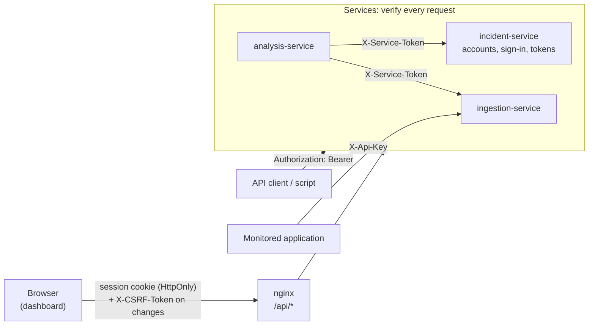

# Security

How the platform authenticates users and services, what it protects, and what it does not do.
The design favours a small, understandable setup for a single deployment; it is not an
enterprise identity system.

## Overview

| Who | Credential | Where it is checked |
| --- | --- | --- |
| A person using the dashboard | Access token (JWT) in the HttpOnly cookie `rcp_session`; CSRF token on changes | All three services |
| An API client or script acting for a person | The same access token as `Authorization: Bearer` | All three services |
| A monitored application sending events | Ingestion API key, `X-Api-Key` | ingestion-service (`POST /api/v1/logs` only) |
| analysis-service reading incidents and events | Internal service token, `X-Service-Token` | incident-service and ingestion-service (`GET` only) |
| Kafka (ingestion-service → incident-service) | None at the application level; the broker is only reachable inside the Compose network and from the host | — |

The Kafka path is unchanged: correlation does not involve users or tokens.

## Accounts and roles

incident-service owns the accounts (table `auth.users`, see
[database.md](database.md#authusers)) and is the only service that issues tokens.

| Role | Can |
| --- | --- |
| `VIEWER` | Read everything: overview, events, incidents, analyses, health |
| `ADMIN` | Everything a viewer can, plus run an analysis and the deprecated manual incident creation; future administrative actions use this role |

The roles are checked by each service for each request ([api.md](api.md#authentication) has the
full table). The dashboard also hides what a role cannot use (a viewer sees no "Run analysis"
button), but that is only for convenience: the services refuse the request regardless.

### Passwords

- Stored only as BCrypt hashes (cost 12) by Spring Security's `DelegatingPasswordEncoder`, with
  the algorithm as a prefix (`{bcrypt}$2a$12$...`). A database check constraint rejects anything
  that is not an encoded hash.
- New passwords need 12–72 bytes (BCrypt uses at most 72) and must differ from the username.
- Sign-in answers the same `401` for an unknown username, a wrong password and a disabled
  account, and checks a dummy hash for unknown usernames so the response time does not reveal
  which accounts exist.
- Passwords are never logged or returned. Request objects that hold them redact themselves in
  `toString()`. The sign-in form reads the password from the form field at submit time and keeps
  it in no application state; the field is cleared after a failed attempt.

### Initial accounts

There is no sign-up. For local development, incident-service creates accounts at startup from
environment variables, **only if the username does not exist yet** (an existing account is never
changed, so a later password change survives restarts):

| Variable | Account |
| --- | --- |
| `AUTH_BOOTSTRAP_ADMIN_USERNAME`, `AUTH_BOOTSTRAP_ADMIN_PASSWORD` | First `ADMIN` |
| `AUTH_BOOTSTRAP_VIEWER_USERNAME`, `AUTH_BOOTSTRAP_VIEWER_PASSWORD` | Optional `VIEWER` |

Set them in `.env` (git-ignored), with your own passwords. A password that breaks the rules
above stops incident-service with a message naming the variable (never its value). Without them,
no account is created and incident-service logs a warning. In any shared deployment, change the
initial password after the first sign-in (`PUT /api/v1/auth/password`) and remove it from the
environment. Further accounts, disabling and role changes are done in the database for now (no
user-management API or UI).

## Access tokens and the session cookie

- **Format.** JWT signed with HS256 using `AUTH_JWT_SECRET` (at least 32 bytes; every service
  refuses to start without it). Claims: `sub` (user ID), `username`, `role`, `csrf`, `iss`
  (`root-cause-platform`), `aud` (`root-cause-platform-api`), `iat`, `exp`, `jti`. No password
  data or personal details.
- **Verification** in every service: signature with HS256 only (`alg: none` and other algorithms
  are rejected), issuer, audience, expiry (30 s clock tolerance), issue time not in the future,
  and a known role. Spring Security's Nimbus JOSE decoder in the Java services, PyJWT in
  analysis-service.
- **Lifetime.** `AUTH_TOKEN_TTL`, 60 minutes by default. There is no refresh token: when the
  token expires, the dashboard returns to the sign-in page with a message, and the user signs in
  again.
- **Storage in the browser.** The token is only in the cookie `rcp_session`: `HttpOnly` (scripts
  cannot read it), `SameSite=Strict` (not sent with requests started by other sites), `Path=/`,
  and `Secure` when `AUTH_COOKIE_SECURE=true`, which is required when the dashboard is served
  over HTTPS (it is `false` by default because the local stack uses plain HTTP). Nothing is put
  in `localStorage` or `sessionStorage`; the dashboard keeps only the user, the expiry time and
  the CSRF token in memory and asks `GET /api/v1/auth/me` after a reload.
- **Why one shared key.** All three services verify tokens with the same secret, so each of them
  could also create tokens. That is acceptable here because they are deployed and trusted
  together; with independently operated services, asymmetric keys (incident-service signs, the
  others verify with a public key) would be the next step.

## CSRF

The browser sends the cookie automatically, so state-changing requests that are authenticated by
the cookie must also carry the session's CSRF token in `X-CSRF-Token` (`403` otherwise). The token
is a random value created at sign-in, stored in the access token's `csrf` claim and returned in the
sign-in and `/me` responses; the dashboard keeps it in memory. Another site can neither read it nor
make the browser send the header. `SameSite=Strict` is a second layer.

Requests with `Authorization: Bearer` need no CSRF token, because browsers never add that header
by themselves. Sign-in itself has no session yet; it accepts only `application/json`, which a
cross-site form cannot send.

## Service-to-service authentication

analysis-service is the only service that calls another over HTTP. Its calls to incident-service
and ingestion-service carry `X-Service-Token: <INTERNAL_SERVICE_TOKEN>` and never the user's
cookie or token. That credential is accepted only for reading (`GET`) incidents and events, is not
accepted by the analysis API, and cannot be used as a bearer token; a user token sent as a service
token is rejected too. All tokens and keys are compared in constant time.

| Call | Authenticated as |
| --- | --- |
| Browser → any API (through nginx) | User (cookie) |
| Script/API client → any API | User (bearer token) |
| Monitored application → `POST /api/v1/logs` | Log producer (API key) |
| analysis-service → incident-service, ingestion-service | Internal service (service token) |
| ingestion-service → Kafka → incident-service | Not an HTTP call; no user involved |
| Docker health checks → `/actuator/health/**`, `/health/readiness` | Public |

## Rate limits

In memory, per service instance: each instance counts on its own and a restart resets the counts.
That is enough to slow down password guessing and accidental floods on this single-instance
deployment; several instances would need a shared store.

| What | Default | Setting |
| --- | --- | --- |
| Failed sign-ins per username | 5 per 15 minutes | `AUTH_LOGIN_MAX_FAILURES_PER_USER`, `AUTH_LOGIN_FAILURE_WINDOW` |
| Failed sign-ins per client address | 20 per 15 minutes | `AUTH_LOGIN_MAX_FAILURES_PER_CLIENT` |
| Events per client address | 600 per minute | `INGESTION_RATE_LIMIT_PER_MINUTE` |
| Manual analyses per user | 30 per minute | `ANALYSIS_RATE_LIMIT_PER_MINUTE` |

Exceeding a limit gives `429` with `Retry-After`. While the per-username limit is reached, even the
correct password is refused, which also means repeated wrong attempts can lock a known username
out for the window.

The client address comes from `X-Forwarded-For`, which nginx overwrites with the real address of
the browser; the Spring services trust that header only from private network addresses (the
Compose network). Requests sent directly to the service ports from the host also come from such
an address, so in a real deployment only the proxy should be reachable.

## Input hardening

- Request bodies over 1 MB are rejected with `413` before they are read (nginx and both Spring
  services); bodies without `Content-Length` with `411`.
- Every query parameter is bounded: search text up to 200 characters, names up to 100, page
  numbers up to 10,000, page sizes up to 100, time windows to their documented ranges. UUIDs and
  enum values are validated (`400`). Event fields keep their Phase 2 limits.
- All SQL is parameterized (Spring Data JPA criteria, named parameters, psycopg parameters). The
  text searches escape `%`, `_` and `\` and use them only as values. Tests send SQL-like strings
  and check that they match nothing and change nothing.
- The dashboard renders all text from monitored applications (messages, stack traces, titles) as
  text through React, never as HTML; there is no `dangerouslySetInnerHTML`. A test renders
  `<script>` and `` strings and checks that no element is created.

## Security headers

| Header | Dashboard (nginx) | API responses (services) |
| --- | --- | --- |
| `Content-Security-Policy` | `default-src 'self'`; scripts, styles, fonts and requests only from the same origin; `object-src 'none'`; `frame-ancestors 'none'` | `default-src 'none'; frame-ancestors 'none'` |
| `X-Content-Type-Options` | `nosniff` | `nosniff` |
| `X-Frame-Options` | `DENY` | `DENY` |
| `Referrer-Policy` | `same-origin` | `no-referrer` |
| `Permissions-Policy` | camera, microphone, geolocation, payment, USB disabled | same |
| `Cache-Control` | `no-cache` for pages, long-lived for hashed assets | `no-store` |
| `Cross-Origin-Opener-Policy` | `same-origin` | — |

nginx also hides its version (`server_tokens off`). analysis-service leaves the CSP off its
interactive API docs (`/docs`, `/redoc`), which load Swagger UI from a CDN.

**HSTS** is deliberately not sent: the local stack uses plain HTTP, and HSTS on `localhost` would
make browsers refuse it. Behind an HTTPS proxy, enable the commented
`Strict-Transport-Security` line in `frontend/security-headers.conf` and set
`AUTH_COOKIE_SECURE=true`. Spring Security only sends HSTS on HTTPS requests anyway.

## CORS

None of the services sends CORS headers, so browsers do not let other origins call the APIs. The
dashboard does not need CORS: in Docker, nginx serves it and proxies `/api/*` from the same
origin, and in development the Vite dev server does the same. There is no wildcard and no
credentialed cross-origin access. Serving the dashboard from another origin would need an
explicit allow-list for that origin.

## Security logging

One structured log line per event, with the request's correlation ID:

| `action` | When |
| --- | --- |
| `auth.login.success` | Sign-in (user ID, username, role, client address) |
| `auth.login.failure` | Failed sign-in, with the internal reason (`unknown_user`, `wrong_password`, `account_disabled`) and the attempted username |
| `auth.logout` | Sign-out |
| `auth.unauthenticated` | Request without a valid credential (`missing_credentials`, `invalid`, `expired`) |
| `auth.forbidden` | Request refused for the role (principal kind, ID, role, path) |
| `auth.csrf_rejected` | Cookie-authenticated change without a valid CSRF token |
| `auth.service_token_rejected`, `auth.api_key_rejected` | Wrong internal service token or ingestion key |
| `auth.password_change.success`, `auth.password_change.failure` | Password changes |
| `auth.user.create` | Account created at startup |
| `rate_limit.exceeded` | A rate limit was reached |

Passwords, tokens, keys and `Authorization` headers are never logged.

## Demo mode

The demo build (`npm run build:demo`) has a built-in synthetic session ("Demo visitor") instead
of sign-in: no credentials are bundled, no sign-in or API request is made, and every page stays
labelled "Demo data". Live builds always require signing in.

## Limitations

- **Tokens cannot be revoked before they expire.** Sign-out deletes the cookie, but a token copied
  before (for example by malware on the user's machine) stays valid for the rest of its lifetime.
  A disabled account is refused by `/api/v1/auth/me` (so the dashboard signs it out on reload),
  but its token keeps working with the other endpoints until it expires. Changing a password does
  not end existing sessions.
- **No refresh tokens or sliding sessions**: users sign in again after `AUTH_TOKEN_TTL`.
- **Sign-in depends on incident-service.** While it is down, nobody can sign in, and reloading the
  dashboard leads to the sign-in page (with an explanation) because the session cannot be
  confirmed. A dashboard that is already open keeps working with the other services, which verify
  tokens themselves.
- **No multi-factor authentication, account lockout notifications, password reset by email or
  user-management API/UI.**
- **One shared signing key** for the three services (see above).
- **Rate limits are in memory per instance** and keyed by client address as reported by the
  proxy (see above).
- **The service ports are published on the host** for development. Anything that can reach them
  directly bypasses nginx (but not the services' own authentication).
- **Kafka and PostgreSQL** use the local development setup: no TLS, plaintext Kafka listeners,
  and one database user for all services.
- No formal security audit or penetration test has been done.
